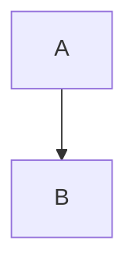

# Every block type

A paragraph with **bold**, *italic*, ~~strike~~, `code` and a [link](https://example.com).


```rust
fn main() {}
```

> A quote.

> [!TIP]
> A callout.

- bullet
- list

3. ordered
4. list

- [x] done
- [ ] todo

| a | b |
|---|--:|
| 1 | 2 |

Footnote use[^n].

[^n]: The footnote.

$$
E = mc^2
$$



---
