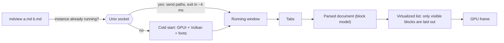

# mdview documentation

mdview is a read-only Markdown viewer that should start as fast as possible.
It's built on [GPUI](https://gpui.rs), the GPU-accelerated UI framework behind
the Zed editor. These docs are for people and AI agents who want to work on it.

## What the project is (and isn't)

**Goals**, in priority order:

1. **Startup time.** From a cold start to the first frame should take
   milliseconds. Opening a file when a window is already running should feel
   instant.
2. **Rendering quality.** The rendered Markdown should look as good as
   GitHub's or Zed's preview.
3. **Small and simple.** Few dependencies and little code. We don't add
   features "just in case".

**Non-goals.** These are out of scope:

- Editing, showing the Markdown source, or split views.
- Plugins, settings UI, or project/workspace concepts.
- Anything that adds noticeable startup cost without a clear reason. See the
  [performance rules](contributing.md#performance-rules).

## Map of the docs

| Document | Read it when you want to… |
| --- | --- |
| [architecture.md](architecture.md) | Understand the modules, threads and data flow |
| [startup.md](startup.md) | Work on startup time, or learn how it's measured |
| [rendering.md](rendering.md) | Change how Markdown looks, or add support for new syntax |
| [gpui-fork.md](gpui-fork.md) | Touch `crates/gpui`, or upgrade GPUI |
| [contributing.md](contributing.md) | Build, test and send changes (people and agents) |
| [roadmap.md](roadmap.md) | Find something to work on |

AI agents should also read [`AGENTS.md`](../AGENTS.md) in the repo root.

## The project at a glance

mdview renders these Mermaid diagrams itself (see
[rendering.md](rendering.md#mermaid-diagrams)), so `mdview docs/*.md` is a
good way to read these docs.
