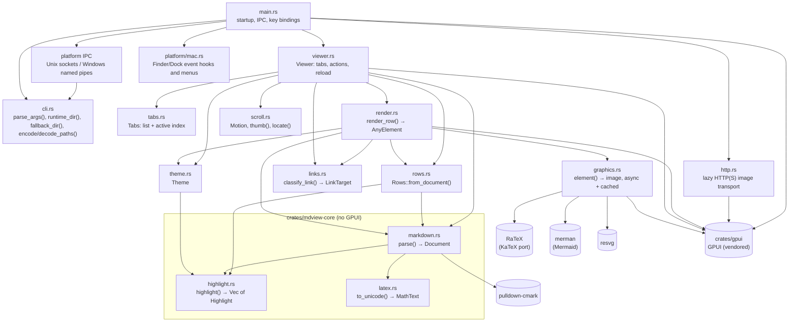
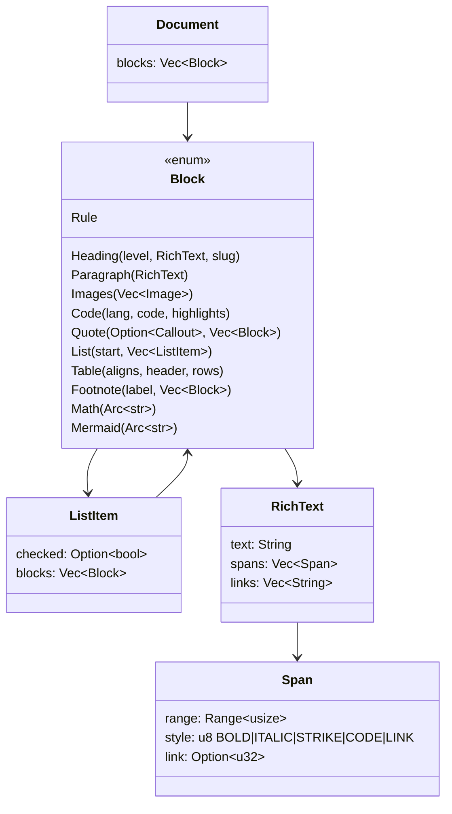
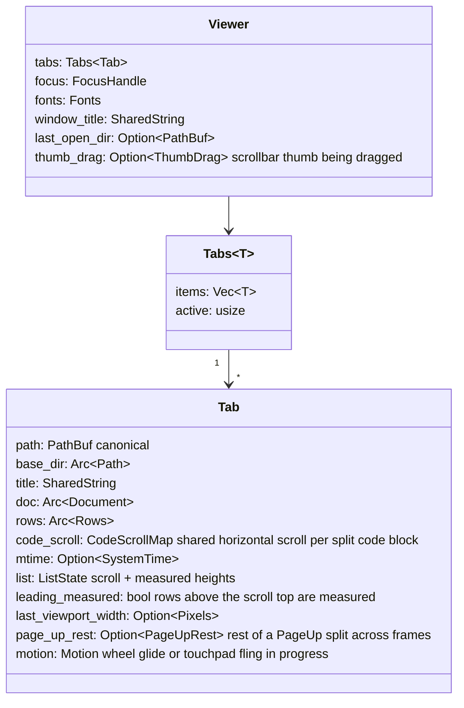
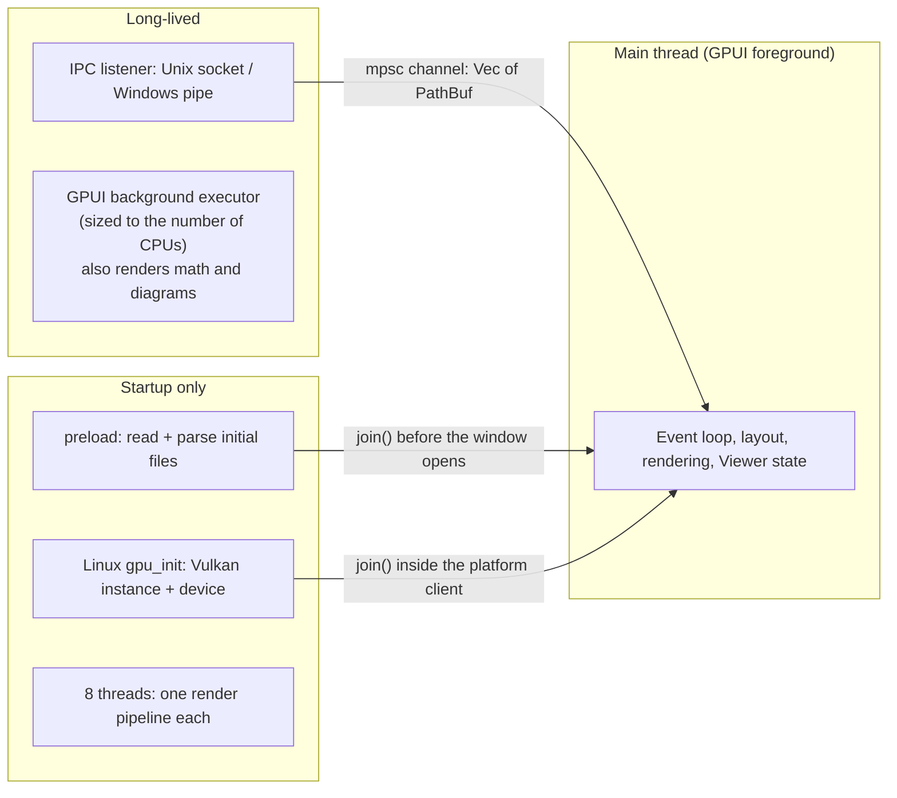
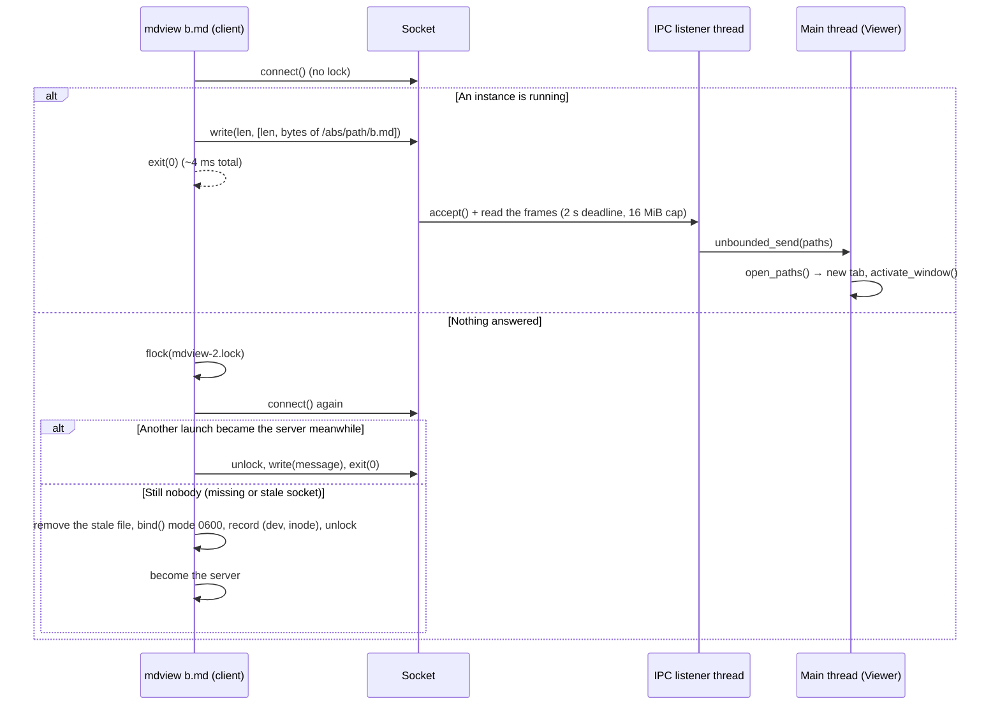
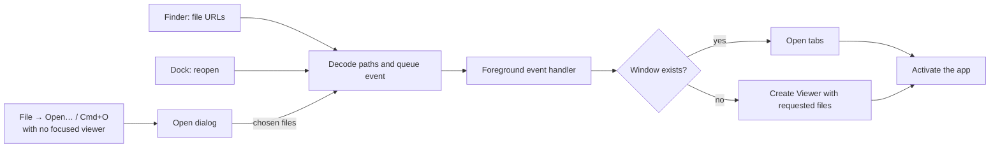

# Architecture

## Repository layout

```
.
├── src/
│   ├── main.rs        Entry point: IPC/events, key bindings, font choice, window creation
│   ├── platform/      OS integration; unix.rs owns Unix sockets, windows.rs owns named pipes, mac.rs handles Finder/Dock
│   ├── cli.rs         Argument parsing, help text, socket directory and message format (GUI-free)
│   ├── viewer.rs      The `Viewer` view: tabs, actions, live reload, drag & drop, file loading
│   ├── tabs.rs        `Tabs<T>`: the tab list and active index (GUI-free, unit-tested)
│   ├── graphics.rs    Display math and Mermaid → images: background rendering + LRU cache
│   ├── render.rs      Block model + rows → GPUI elements; link handling
│   ├── rows.rs        `Rows`: splits large top-level blocks into virtualized list rows (GUI-free, unit-tested)
│   ├── scroll.rs      Smooth wheel glides, touchpad flings, scrollbar geometry (GUI-free, unit-tested)
│   ├── http.rs        Lazy HTTP(S) image transport on the blocking pool
│   ├── links.rs       Link routing (`classify_link`), percent-decoding, anchor lookup (GUI-free)
│   └── theme.rs       Light and dark palettes
├── crates/mdview-core/  The GUI-free core, a separate crate so it can't depend on GPUI
│   └── src/
│       ├── markdown.rs    Markdown → block model (pulldown-cmark), plus parser tests
│       ├── highlight.rs   Syntax highlighting for code blocks (hand-written lexers)
│       └── latex.rs       Inline math: LaTeX → Unicode text
├── crates/gpui/       Vendored GPUI 0.2.2 with startup fixes (see gpui-fork.md)
├── patches/           Those fixes as a diff against upstream GPUI
├── examples/          Sample Markdown files for manual testing
└── docs/              This documentation
```

## Modules and dependencies



Rules that keep this structure simple:

- **`markdown.rs`, `highlight.rs` and `latex.rs` know nothing about GPUI.**
  They live in their own crate, `crates/mdview-core`, which doesn't depend on
  GPUI, so the compiler enforces this. They turn text into plain data
  (`Document`). That keeps them fast, easy to unit-test (`cargo test -p
  mdview-core` builds and runs in seconds) and safe to run on any thread. The
  app re-exports them at its crate root, so app code still writes
  `crate::markdown`.
- **`render.rs` only reads that data.** It never parses Markdown again. It's
  the only place where Markdown concepts become visual elements.
- **`viewer.rs` owns all state**: tabs, which tab is active, scroll positions
  and file modification times.

## Data model

The parser output is a tree of `Block`s. Inline formatting is flattened into
`RichText`: one `String` plus non-overlapping style spans.



Top-level blocks are projected into display rows by `rows.rs` (see
[rendering.md](rendering.md)): simple blocks become one row, while tables,
lists, large code blocks and multi-block quotes are split into multiple rows
so virtualization keeps scrolling smooth. Blocks nested inside a list item or
quote child are drawn as part of their parent's row.

## Runtime state



- Paths are canonicalized (`normalize`), so opening the same file twice just
  switches to its tab (`Tabs::activate_first`).
- Opening several paths (at startup, from a second `mdview` launch, or from
  the open dialog) handles them in order so the last path ends up active,
  whether it was already open or not (`Viewer::show_path`, used by
  `Viewer::new` and `Viewer::open_paths`).
  Paths delivered after startup skip directories (`viewer::openable`, used by
  `Viewer::open_paths` and by `deliver_paths` when it recreates a closed
  window), whereas startup loads every CLI argument, showing an error tab for
  a directory.
- Closing a tab keeps the active tab if it's still open. Closing the active
  tab activates its right neighbor, or its left one if it was the last
  (`Tabs::close`). Next/previous tab wrap around.
- `Tab::replace` swaps in a newly parsed document and keeps the scroll
  position on the same block, even when earlier blocks grew or shrank
  (`Rows::remap_row`, see [rendering.md](rendering.md)). Live reload and
  `Ctrl+R` both use it.
- The open-file dialog (`Ctrl+O` / `Cmd+O`, `viewer::prompt_open`) starts in
  the active tab's parent directory, falling back to `last_open_dir`
  (in-memory only, updated as files are opened) and then the process working
  directory. The focused viewer handles `Open` and stops it there. When no
  viewer does (no window, or focus elsewhere), an app-level handler in
  `serve_paths` shows the same dialog from the working directory and sends
  the chosen files down the path channel, like IPC.

## Threads



- The startup threads are created once and joined. Their number doesn't depend
  on the machine; the operating system spreads them over however many cores
  there are.
- All `Viewer` state lives on the main thread. Work on other threads talks to
  it only through a channel (`futures::channel::mpsc`), or through
  `WeakEntity::update` from an async task.
- `graphics.rs` renders math and diagrams on the background executor and stores the
  result in a GPUI `Global` cache from the main thread, then notifies the
  `Viewer`. See [rendering.md](rendering.md#images-rendered-in-the-background).
- Live reload is an async task on the main thread: a 750 ms timer, then
  `stat()` on each open file. It doesn't use a file-watcher thread.

## Single-instance protocol

`platform/unix.rs` implements it; `cli.rs` holds the pure parts (where the
socket lives, the message format).

**Where.** The socket is `mdview-2.sock` in `$XDG_RUNTIME_DIR`
(`cli::runtime_dir`). The XDG spec makes that directory private to the user,
but mdview doesn't take it on trust: before every use it strips any trailing
`/` or `/.`, checks every ancestor up to `/` (owned by the current uid or
root, and writable by nobody else unless sticky, with no `..` components or
foreign-owned symlinks), and checks the directory itself with `lstat` (real
directory, not a symlink, owned by the current uid, mode 0700). When
`XDG_RUNTIME_DIR` is unset (always on macOS, often over SSH), empty or
relative, or fails that check (mdview then prints why), the socket is in
`$TMPDIR/mdview-$UID/` instead (`cli::fallback_dir`), with the same ancestor
and `lstat` checks. If a check fails, mdview prints why and runs as a
separate instance.

Since the directory and its ancestors are safe from other users, other users
can't connect to the socket or plant one, even in the moment between `bind()`
and the `chmod` that makes the socket mode 0600. The lock file is opened with
`O_NOFOLLOW | O_NONBLOCK`, verified via `fstat` as a regular file owned by
the user with no group or other bits, and `fchmod`-ed to `0600` if a
restrictive umask stripped owner permissions. This protects against other
users, not against processes running as the same user.

**Versions.** The `2` in `mdview-2.sock` (and `mdview-2.lock`) is the wire
protocol version, bumped with every incompatible change to the message.
mdview 0.2.0 and older used `mdview.sock` with one path per line. With
different names, an upgraded client and an older running instance (or the
reverse) don't see each other, so each launch opens its own window instead
of sending paths the other side would silently drop.

**Message.** The client writes one message and closes the connection: a
little-endian `u32` body length, then for each absolute path a little-endian
`u32` byte count and the path's raw OS bytes. An empty list just raises the
window. Paths are never empty and never contain NUL (neither can be a Unix
path), and a message carries at most `cli::MAX_PATHS` (65,536) of them; a
message that breaks these rules is dropped whole.
`cli::encode_paths` / `cli::decode_paths` implement it. Because it
carries the bytes and not a display string, every Unix path arrives exactly
as given: newlines, a trailing `\r` and non-UTF-8 bytes included.

**Limits.** The body is capped at `cli::MAX_MESSAGE` (16 MiB, like the
Windows pipe): the listener checks the header before it reads anything, and
a client with more paths than fit (or more than `MAX_PATHS`) opens its own
window. The listener reads one client at a time and gives each 2 seconds for
its whole message, so a client that stalls or trickles bytes can't block
later handoffs. Truncated,
oversized, malformed or late messages are dropped without stopping the
listener.

**Taking over.** Only a launch that can't connect takes the lock
(`flock` on `mdview-2.lock` next to the socket, which is never deleted). Under
the lock it connects again, because another launch may have just become the
server; if nobody answers, the socket is stale, so it removes it and binds its
own. Two launches started together therefore elect one server instead of
unlinking each other's socket. At exit, `cleanup()` takes the lock (and
leaves everything alone if it can't) and removes the socket only if its `(dev, inode)` is still the one this process
bound, so it can't delete a newer instance's socket.



`-n` / `--new` skips the protocol and doesn't bind the socket. That's useful
for benchmarks and debugging.

## Links

`links::classify_link` decides what clicking a link does (it returns a
`LinkTarget`, which `render::open_link` acts on):

| Link | Action |
| --- | --- |
| `#anchor` | Scroll the current tab to the heading whose slug matches |
| `http(s)://…`, `mailto:` | Open with the system handler (`cx.open_url`) |
| Relative or absolute `*.md` (with an optional `#anchor`) | Open in a tab (or switch to it), then scroll to the anchor |
| Any other local file | Open with the system handler (percent-encoded `file://…`) |

Anchor slugs follow GitHub's rules (`markdown::slugify`) and are matched
case-insensitively (`links::heading_index`). Only top-level headings can be
anchor targets. The path and the anchor are percent-decoded separately, so
`a%23b.md` is a file named `a#b.md`. Only `://` and `mailto:` count as
external; a query string (`b.md?x=1`) stays part of the file name.

## Windows integration

Windows uses GPUI's Direct3D 11 renderer and DirectWrite text. Single-instance
handoff uses a local named pipe scoped by the current token's SID, with an ACL
allowing only that user and rejecting remote clients. The client grants the
server permission to activate its window. Messages are length-prefixed UTF-16
paths (bounded to 16 MiB), preserving Unicode and unpaired surrogate units.
The client waits for a server acknowledgement before closing the pipe, so
requests arriving during first-window startup cannot disconnect too early.
`--new` skips IPC. Pipe handles are released by the OS at exit.

Unix file URLs use the existing URL library to percent-encode names. Windows
opens non-Markdown local files through ShellExecute with native UTF-16 paths,
preserving drive, UNC and verbatim paths without URL conversion. Segoe UI and Consolas are font fallbacks;
font environment overrides remain available. The optimized Windows executable
uses the GUI subsystem so opening files does not create a console window.

Windows initial client dimensions are capped to the display with room for the
native frame and taskbar, preserving the preferred 920×1040 size on larger
monitors and the 320×240 minimum. This avoids centering an oversized window
with an inaccessible title bar on small desktops.

## macOS integration

GPUI uses Metal and native macOS text rendering. `platform/mac.rs` registers
LaunchServices file-open events and Dock reopen events before the application
runs, queueing them on the same foreground channel as IPC. File URLs are
decoded with the existing URL library. Event delivery (`deliver_paths`)
reuses the current window; if it was closed, it creates the same Viewer
again, skipping directories as `Viewer::open_paths` does. Either way it calls
`cx.activate(true)`, because raising a window doesn't bring the app in front
of the Terminal or Finder that sent the paths (on Linux and Windows the call
does nothing). Closing the last window keeps the macOS app running; Quit
exits and cleans up its Unix socket. `File → Open…` and `Cmd+O` keep working
then: `Open` also has an app-level handler, which keeps the menu item enabled
and feeds the chosen files into the same channel, so the one tracked window
handle is recreated once and reused by later Finder, Dock and IPC events.
Event-registration hooks delegate to GPUI and let headless tests
exercise event delivery. Shared `viewer_window_options` preserves the native
window contract across initial opens and reopens. Command shortcuts and native
menus supplement the shared Control bindings.
Helvetica Neue and Menlo are available as native font fallbacks.


