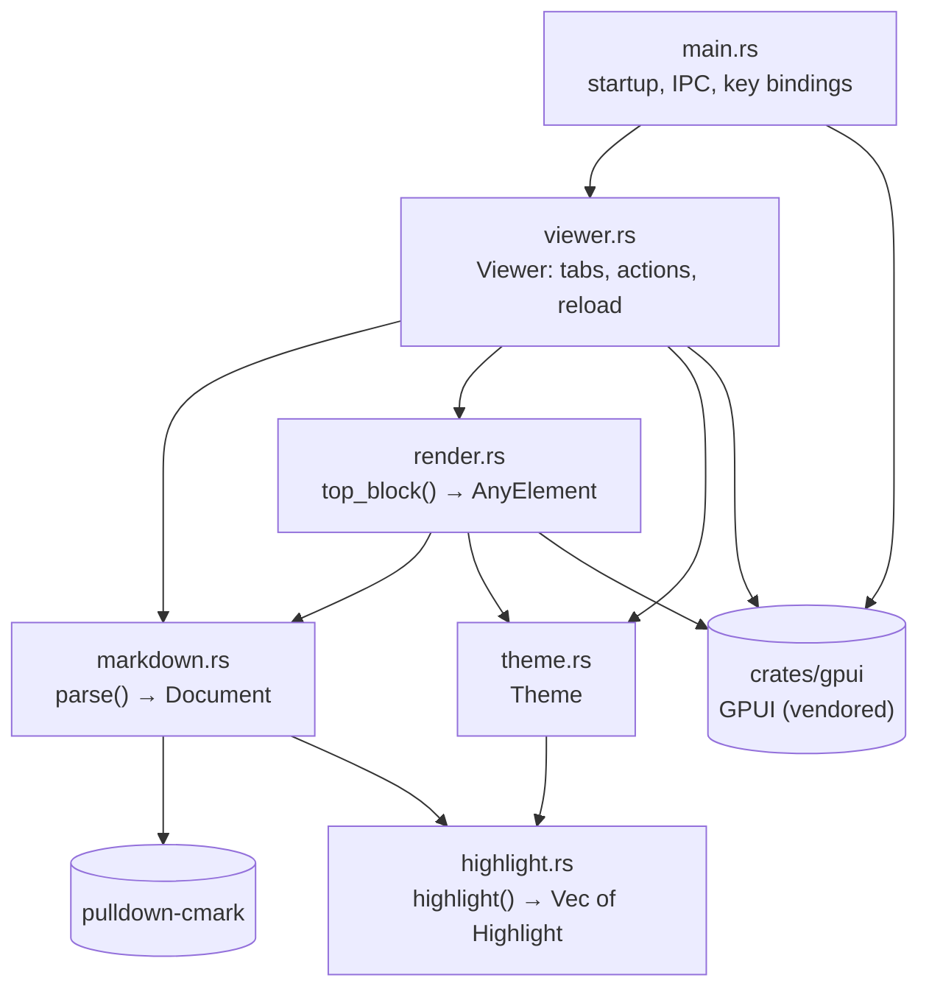
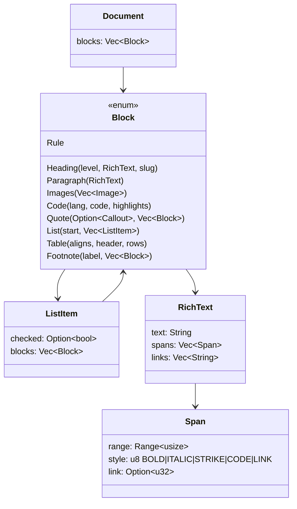
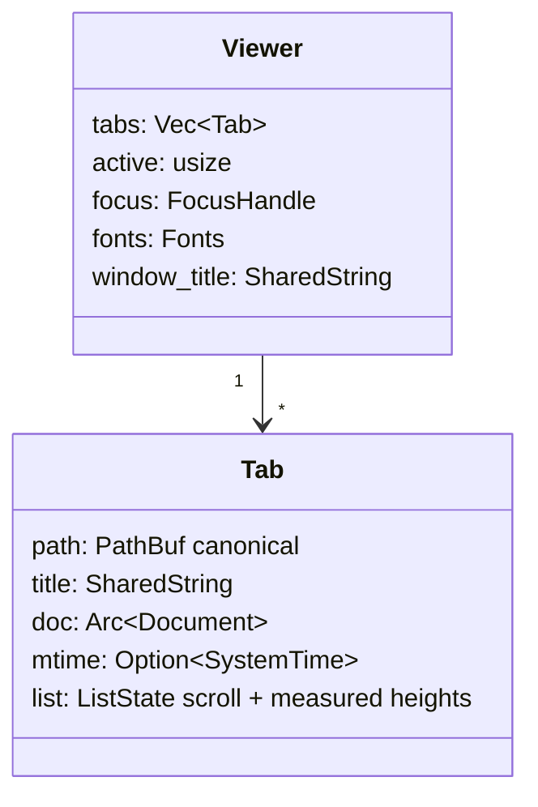
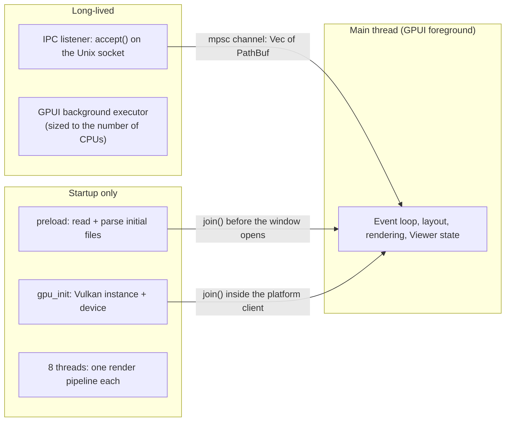
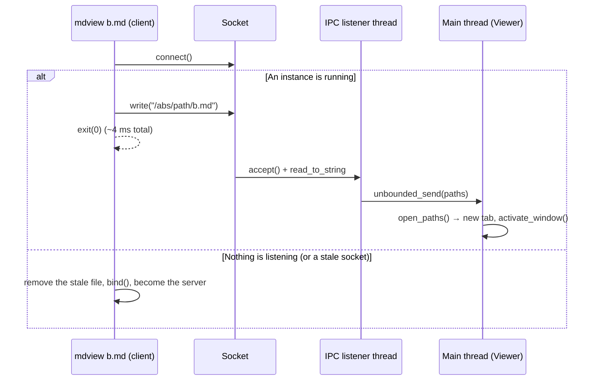

# Architecture

## Repository layout

```
.
├── src/
│   ├── main.rs        Entry point: arguments, single-instance socket, key bindings, font choice, window creation
│   ├── viewer.rs      The `Viewer` view: tabs, actions, live reload, drag & drop, file loading
│   ├── markdown.rs    Markdown → block model (pulldown-cmark), plus parser tests
│   ├── highlight.rs   Syntax highlighting for code blocks (hand-written lexers, no GPUI)
│   ├── render.rs      Block model → GPUI elements; link handling
│   └── theme.rs       Light and dark palettes
├── crates/gpui/       Vendored GPUI 0.2.2 with startup fixes (see gpui-fork.md)
├── patches/           Those fixes as a diff against upstream GPUI
├── examples/          Sample Markdown files for manual testing
└── docs/              This documentation
```

## Modules and dependencies



Rules that keep this structure simple:

- **`markdown.rs` and `highlight.rs` know nothing about GPUI.** It turns text into plain data
  (`Document`). That keeps it fast, easy to unit-test and safe to run on any
  thread.
- **`render.rs` only reads that data.** It never parses Markdown again. It's
  the only place where Markdown concepts become visual elements.
- **`viewer.rs` owns all state**: tabs, which tab is active, scroll positions
  and file modification times.

## Data model

The parser output is a tree of `Block`s. Inline formatting is flattened into
`RichText`: one `String` plus non-overlapping style spans.



Each **top-level** block becomes one row of the virtualized list (see
[rendering.md](rendering.md)). Blocks nested inside a quote or list are drawn
as part of their parent's row.

## Runtime state



- Paths are canonicalized (`normalize`), so opening the same file twice just
  switches to its tab.
- `Tab::replace` swaps in a newly parsed document and keeps the scroll
  position. Live reload and `Ctrl+R` both use it.

## Threads



- The startup threads are created once and joined. Their number doesn't depend
  on the machine; the operating system spreads them over however many cores
  there are.
- All `Viewer` state lives on the main thread. Work on other threads talks to
  it only through a channel (`futures::channel::mpsc`), or through
  `WeakEntity::update` from an async task.
- Live reload is an async task on the main thread: a 750 ms timer, then
  `stat()` on each open file. It doesn't use a file-watcher thread.

## Single-instance protocol

The socket lives at `$XDG_RUNTIME_DIR/mdview.sock`, or
`$TMPDIR/mdview-$USER.sock` when `XDG_RUNTIME_DIR` isn't set. The protocol is
deliberately trivial: the client writes absolute paths separated by `\n` and
closes the connection. An empty message just raises the window.



`-n` / `--new` skips the protocol and doesn't bind the socket. That's useful
for benchmarks and debugging.

## Links

`render::open_link` decides what clicking a link does:

| Link | Action |
| --- | --- |
| `#anchor` | Scroll the current tab to the heading whose slug matches |
| `http(s)://…`, `mailto:` | Open with the system handler (`cx.open_url`) |
| Relative or absolute `*.md` (with an optional `#anchor`) | Open in a tab (or switch to it), then scroll to the anchor |
| Any other local file | Open with the system handler (`file://…`) |

Anchor slugs follow GitHub's rules (`markdown::slugify`). Only top-level
headings can be anchor targets.
