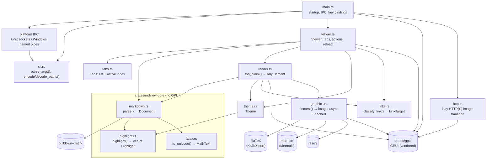
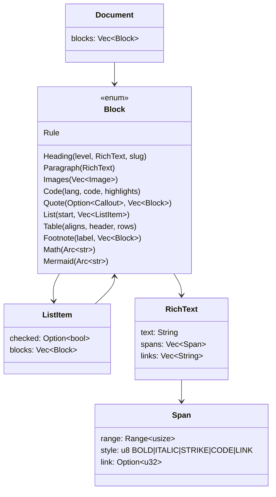
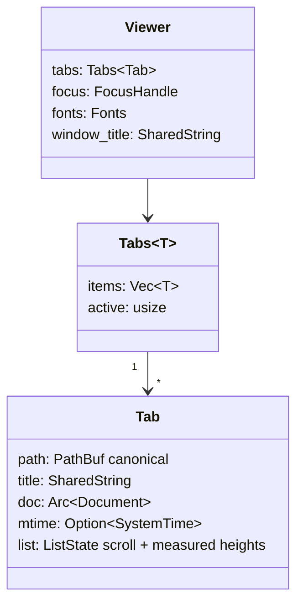
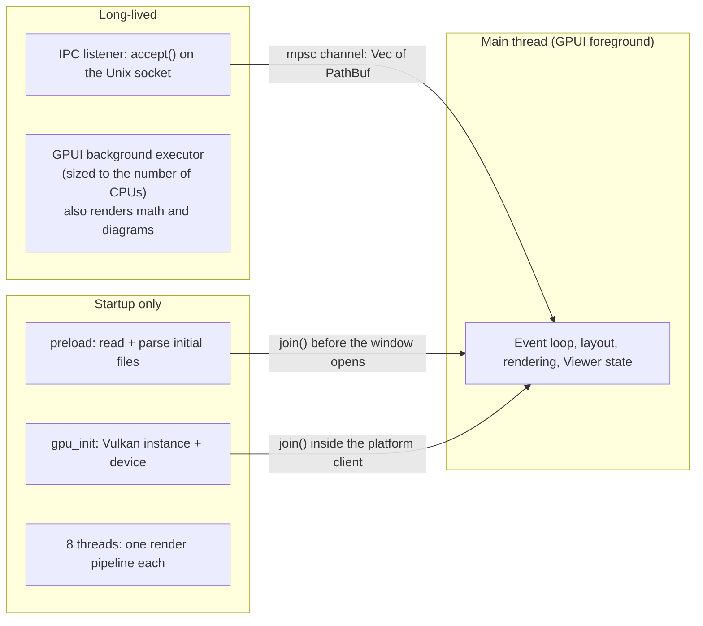
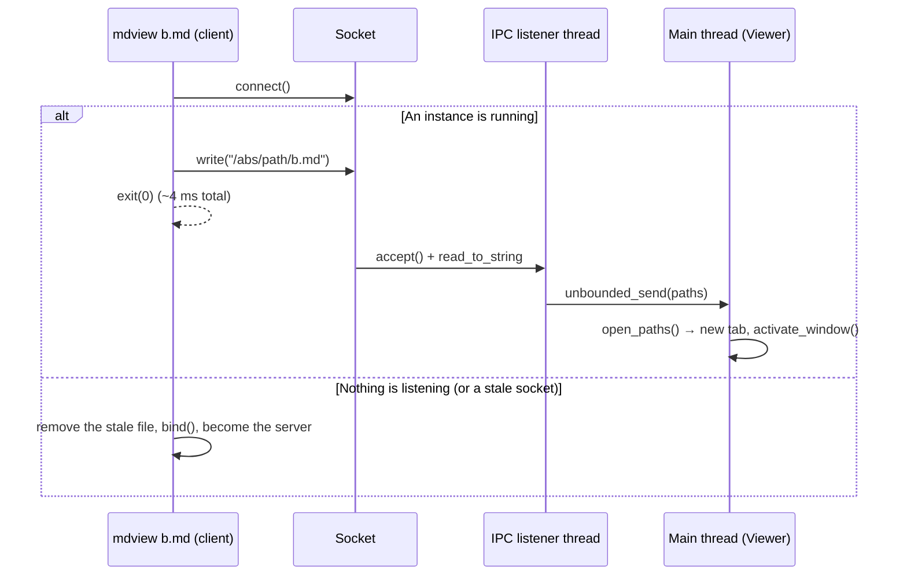

# Architecture

## Repository layout

```
.
├── src/
│   ├── main.rs        Entry point: IPC handoff, key bindings, font choice, window creation
│   ├── platform/      OS integration; unix.rs owns Unix sockets, windows.rs owns named pipes
│   ├── cli.rs         Argument parsing, help text, socket path and message format (GUI-free)
│   ├── viewer.rs      The `Viewer` view: tabs, actions, live reload, drag & drop, file loading
│   ├── tabs.rs        `Tabs<T>`: the tab list and active index (GUI-free, unit-tested)
│   ├── graphics.rs    Display math and Mermaid → images: background rendering + LRU cache
│   ├── render.rs      Block model → GPUI elements; link handling
│   ├── http.rs        Lazy HTTP(S) image transport on the blocking pool
│   ├── links.rs       Link routing (`classify_link`), percent-decoding, anchor lookup (GUI-free)
│   └── theme.rs       Light and dark palettes
├── crates/mdview-core/  The GUI-free core, a separate crate so it can't depend on GPUI
│   └── src/
│       ├── markdown.rs    Markdown → block model (pulldown-cmark), plus parser tests
│       ├── highlight.rs   Syntax highlighting for code blocks (hand-written lexers)
│       └── latex.rs       Inline math: LaTeX → Unicode text
├── crates/gpui/       Vendored GPUI 0.2.2 with startup fixes (see gpui-fork.md)
├── patches/           Those fixes as a diff against upstream GPUI
├── examples/          Sample Markdown files for manual testing
└── docs/              This documentation
```

## Modules and dependencies



Rules that keep this structure simple:

- **`markdown.rs`, `highlight.rs` and `latex.rs` know nothing about GPUI.**
  They live in their own crate, `crates/mdview-core`, which doesn't depend on
  GPUI, so the compiler enforces this. They turn text into plain data
  (`Document`). That keeps them fast, easy to unit-test (`cargo test -p
  mdview-core` builds and runs in seconds) and safe to run on any thread. The
  app re-exports them at its crate root, so app code still writes
  `crate::markdown`.
- **`render.rs` only reads that data.** It never parses Markdown again. It's
  the only place where Markdown concepts become visual elements.
- **`viewer.rs` owns all state**: tabs, which tab is active, scroll positions
  and file modification times.

## Data model

The parser output is a tree of `Block`s. Inline formatting is flattened into
`RichText`: one `String` plus non-overlapping style spans.



Each **top-level** block becomes one row of the virtualized list (see
[rendering.md](rendering.md)). Blocks nested inside a quote or list are drawn
as part of their parent's row.

## Runtime state



- Paths are canonicalized (`normalize`), so opening the same file twice just
  switches to its tab (`Tabs::activate_first`).
- Closing a tab keeps the active tab if it's still open. Closing the active
  tab activates its right neighbor, or its left one if it was the last
  (`Tabs::close`). Next/previous tab wrap around.
- `Tab::replace` swaps in a newly parsed document and keeps the scroll
  position. Live reload and `Ctrl+R` both use it.

## Threads



- The startup threads are created once and joined. Their number doesn't depend
  on the machine; the operating system spreads them over however many cores
  there are.
- All `Viewer` state lives on the main thread. Work on other threads talks to
  it only through a channel (`futures::channel::mpsc`), or through
  `WeakEntity::update` from an async task.
- `graphics.rs` renders math and diagrams on the background executor and stores the
  result in a GPUI `Global` cache from the main thread, then notifies the
  `Viewer`. See [rendering.md](rendering.md#images-rendered-in-the-background).
- Live reload is an async task on the main thread: a 750 ms timer, then
  `stat()` on each open file. It doesn't use a file-watcher thread.

## Single-instance protocol

The socket lives at `$XDG_RUNTIME_DIR/mdview.sock`, or
`$TMPDIR/mdview-$USER.sock` when `XDG_RUNTIME_DIR` isn't set. The protocol is
deliberately trivial: the client writes absolute paths separated by `\n` and
closes the connection. An empty message just raises the window.
`cli::encode_paths` / `cli::decode_paths` implement it. Because it's text,
it can't carry every path: non-UTF-8 bytes arrive as U+FFFD, a `\n` inside
a path splits it, and a `\r` before a `\n` is dropped.



`-n` / `--new` skips the protocol and doesn't bind the socket. That's useful
for benchmarks and debugging.

## Links

`links::classify_link` decides what clicking a link does (it returns a
`LinkTarget`, which `render::open_link` acts on):

| Link | Action |
| --- | --- |
| `#anchor` | Scroll the current tab to the heading whose slug matches |
| `http(s)://…`, `mailto:` | Open with the system handler (`cx.open_url`) |
| Relative or absolute `*.md` (with an optional `#anchor`) | Open in a tab (or switch to it), then scroll to the anchor |
| Any other local file | Open with the system handler (percent-encoded `file://…`) |

Anchor slugs follow GitHub's rules (`markdown::slugify`) and are matched
case-insensitively (`links::heading_index`). Only top-level headings can be
anchor targets. The path and the anchor are percent-decoded separately, so
`a%23b.md` is a file named `a#b.md`. Only `://` and `mailto:` count as
external; a query string (`b.md?x=1`) stays part of the file name.

## Windows integration

Windows uses GPUI's Direct3D 11 renderer and DirectWrite text. Single-instance
handoff uses a local named pipe scoped by the current token's SID, with an ACL
allowing only that user and rejecting remote clients. The client grants the
server permission to activate its window. Messages are length-prefixed UTF-16
paths (bounded to 16 MiB), preserving Unicode and unpaired surrogate units.
`--new` skips IPC. Pipe handles are released by the OS at exit.

File URLs use the existing URL library to percent-encode names and represent
drive, UNC and verbatim drive paths. Segoe UI and Consolas are font fallbacks;
font environment overrides remain available. The optimized Windows executable
uses the GUI subsystem so opening files does not create a console window.
