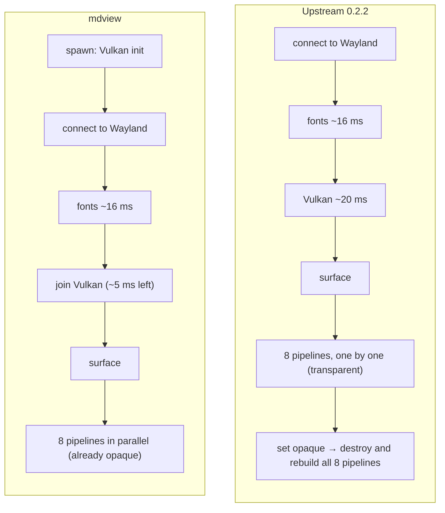
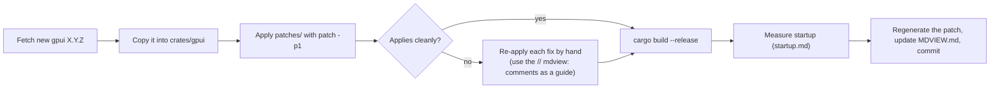

# The vendored GPUI (`crates/gpui`)

mdview uses its own copy of [GPUI](https://crates.io/crates/gpui) 0.2.2. The
copy lives in `crates/gpui` and replaces the crates.io version through
`[patch.crates-io]` in the root `Cargo.toml`. It's identical to upstream
except for three startup fixes and four small follow-up patches.

- Every change is marked in the code with a `// mdview:` comment.
- `patches/gpui-0.2.2-startup.patch` holds the full diff against upstream.
- `crates/gpui/MDVIEW.md` holds short notes plus the measurements.

## Why vendor it

GPUI is the right base: it's GPU-rendered, fast and battle-tested in Zed. But
the published crate does avoidable work at startup. Keeping our own copy lets
us fix that today. The fixes are small and self-contained, so they could also
be sent upstream to Zed.

## The three fixes



| # | Problem | Fix | Files |
| --- | --- | --- | --- |
| 1 | The Wayland renderer always starts with `transparent: true`. Window setup then switches an opaque, server-decorated window to opaque, and `update_transparency` destroys and rebuilds every pipeline. | `WindowParams` carries `window_decorations` and `window_background`, so the renderer starts with the final transparency. | `platform.rs`, `window.rs`, `platform/linux/wayland/window.rs`, `platform/mac/window.rs` (just `..` in a destructuring pattern) |
| 2 | `BladePipelines::new` compiles 8 pipelines one after another. | `std::thread::scope` with one thread per pipeline. Vulkan pipeline creation is thread-safe. | `platform/blade/blade_renderer.rs` |
| 3 | Vulkan init runs after font loading, on the same thread. | `BladeContext::new` runs on its own thread from the start of `WaylandClient::new` / `X11Client::new`, and is joined where the context used to be created. | `platform/linux/wayland/client.rs`, `platform/linux/x11/client.rs` |
| 4 | Untyped `0.0` / `1.0` literals in `taffy.rs` trigger a future-incompat warning. | Explicit `0.0_f32` / `1.0_f32` suffixes. | `taffy.rs` |
| 5 | `PathPromptOptions` has no initial directory, so `Ctrl+O` opens in the portal/OS default folder. | Add `directory: Option<PathBuf>` and pass it to the native open dialog on Linux, macOS and Windows. | `platform.rs`, `platform/linux/platform.rs`, `platform/mac/platform.rs`, `platform/windows/platform.rs` |
| 6 | Wayland drops `wl_pointer.axis_stop`, so nothing tells an app when a touchpad scroll ends, and kinetic scrolling is the client's job on Wayland. GPUI's `List` always scrolls on wheel events itself, and doesn't say how many items it has measured. | A vertical `axis_stop` from a finger becomes a zero-delta `ScrollWheelEvent` with `TouchPhase::Ended`. `List::without_scroll_wheel()` lets the view scroll it, and `ListState::measured_before(n)` returns the measured count and height of the first `n` items. | `platform/linux/wayland/client.rs`, `elements/list.rs` |
| 7 | The test platform panics in `prompt_for_paths` and ignores `activate`, so tests can't cover the Open dialog or app activation. | Queue path prompts (`pending_paths_prompts`, `simulate_paths_selection`) and record activations (`activations`). Test support only. | `platform/test/platform.rs`, `app/test_context.rs` |

The X11 code compiles with fix 3, but it has only been tested on Wayland
(niri).

## Changing the vendored crate

- Keep changes minimal, and mark each one with `// mdview: <why>`.
- Prefer changes that could go upstream. Avoid mdview-specific behavior inside
  GPUI; put that in `src/` instead.
- After any change, regenerate the patch and update `crates/gpui/MDVIEW.md`:

```sh
UP=$(ls -d ~/.cargo/registry/src/index.crates.io-*/gpui-0.2.2)   # needs `cargo fetch` once
diff -ru -x Cargo.lock -x .cargo_vcs_info.json -x MDVIEW.md "$UP" crates/gpui \
  | sed "s#$UP#gpui-0.2.2#; s#crates/gpui#gpui-0.2.2-mdview#" \
  > patches/gpui-0.2.2-startup.patch
```

To get the pristine upstream source when it isn't in the cargo cache: add
`gpui = "=0.2.2"` to a scratch crate and run `cargo fetch`, or download it from
`https://crates.io/api/v1/crates/gpui/0.2.2/download` (it's a `.tar.gz`).

## Upgrading GPUI



1. Check whether upstream already fixed any of the three problems. If so, drop
   that fix.
2. Update the version in `Cargo.toml`. Keep `[patch.crates-io]` pointing at
   `crates/gpui`.
3. Re-check `libc`. GPUI 0.2.2 pulls in `xattr 0.2.3`, which doesn't compile
   with `libc 0.2.191`, so `Cargo.lock` pins `libc` to 0.2.189. If
   `cargo update` breaks the build with `cannot find value ENOATTR`, run
   `cargo update -p libc --precise 0.2.189`.

## Known issues

- With Rust 1.99, `cargo clippy` / `cargo build` show a future-incompatibility
  warning in GPUI's grid layout code (`length(0.0)`, `fr(1.0)`: "falling back
  to `f32`"). It comes from upstream and is harmless today, but a future Rust
  release will turn it into an error. If that happens before upgrading GPUI,
  the fix is to write the literals as `0.0_f32` / `1.0_f32` (and mark the
  change with `// mdview:`).
