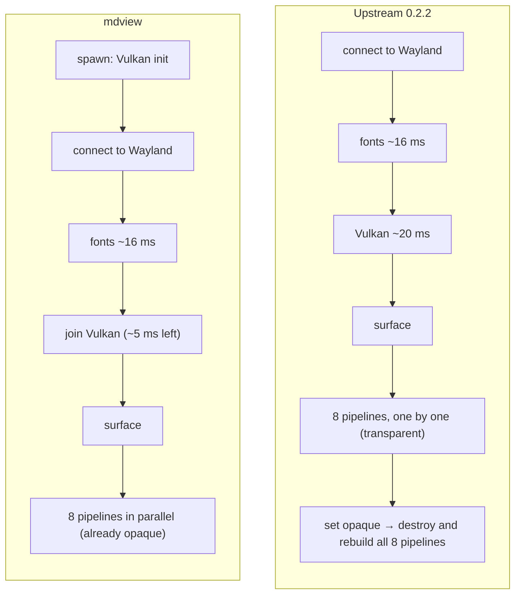
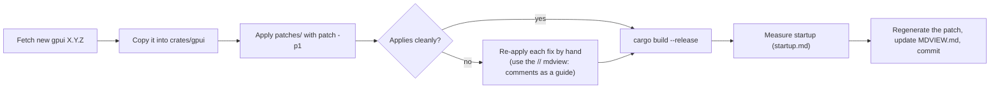

# The vendored GPUI (`crates/gpui`)

mdview uses its own copy of [GPUI](https://crates.io/crates/gpui) 0.2.2. The
copy lives in `crates/gpui` and replaces the crates.io version through
`[patch.crates-io]` in the root `Cargo.toml`. It's identical to upstream
except for three startup fixes, a build fix and an X11 event-loop fix.

- Every change is marked in the code with a `// mdview:` comment.
- `patches/gpui-0.2.2-startup.patch` holds the full diff against upstream.
- `crates/gpui/MDVIEW.md` holds short notes plus the measurements.

## Why vendor it

GPUI is the right base: it's GPU-rendered, fast and battle-tested in Zed. But
the published crate does avoidable work at startup. Keeping our own copy lets
us fix that today. The fixes are small and self-contained, so they could also
be sent upstream to Zed.

## The three fixes



| # | Problem | Fix | Files |
| --- | --- | --- | --- |
| 1 | The Wayland renderer always starts with `transparent: true`. Window setup then switches an opaque, server-decorated window to opaque, and `update_transparency` destroys and rebuilds every pipeline. | `WindowParams` carries `window_decorations` and `window_background`, so the renderer starts with the final transparency. | `platform.rs`, `window.rs`, `platform/linux/wayland/window.rs`, `platform/mac/window.rs` (just `..` in a destructuring pattern) |
| 2 | `BladePipelines::new` compiles 8 pipelines one after another. | `std::thread::scope` with one thread per pipeline. Vulkan pipeline creation is thread-safe. | `platform/blade/blade_renderer.rs` |
| 3 | Vulkan init runs after font loading, on the same thread. | `BladeContext::new` runs on its own thread from the start of `WaylandClient::new` / `X11Client::new`, and is joined where the context used to be created. | `platform/linux/wayland/client.rs`, `platform/linux/x11/client.rs` |

The X11 backend is tested through XWayland: the window tests run on both
backends when `WAYLAND_DISPLAY` and `DISPLAY` are both set (see
[testing.md](testing.md#window-tests)).

## Other fixes

- **Typed float literals** (`taffy.rs`): avoids a future-incompatibility
  warning that will become an error. No behavior change.
- **X11: drain queued events before sleeping** (`platform/linux/x11/client.rs`):
  the X11 fd only wakes the event loop when the socket is readable, but any
  reply wait (including Mesa's Vulkan WSI, which shares the connection) can
  move events into libxcb's queue. When `MapNotify` ended up there during the
  first frame, the window never presented and mdview hung
  ([#12](https://github.com/JorgeAgar/markdown-viewer-zed/issues/12)).
  `X11Client::run` now processes queued events right before the loop blocks.

## Changing the vendored crate

- Keep changes minimal, and mark each one with `// mdview: <why>`.
- Prefer changes that could go upstream. Avoid mdview-specific behavior inside
  GPUI; put that in `src/` instead.
- After any change, regenerate the patch and update `crates/gpui/MDVIEW.md`:

```sh
UP=$(ls -d ~/.cargo/registry/src/index.crates.io-*/gpui-0.2.2)   # needs `cargo fetch` once
diff -ru -x Cargo.lock -x .cargo_vcs_info.json -x MDVIEW.md "$UP" crates/gpui \
  | sed "s#$UP#gpui-0.2.2#; s#crates/gpui#gpui-0.2.2-mdview#" \
  > patches/gpui-0.2.2-startup.patch
```

To get the pristine upstream source when it isn't in the cargo cache: add
`gpui = "=0.2.2"` to a scratch crate and run `cargo fetch`, or download it from
`https://crates.io/api/v1/crates/gpui/0.2.2/download` (it's a `.tar.gz`).

## Upgrading GPUI



1. Check whether upstream already fixed any of these problems. If so, drop
   that fix.
2. Update the version in `Cargo.toml`. Keep `[patch.crates-io]` pointing at
   `crates/gpui`.
3. Re-check `libc`. GPUI 0.2.2 pulls in `xattr 0.2.3`, which doesn't compile
   with `libc 0.2.191`, so `Cargo.lock` pins `libc` to 0.2.189. If
   `cargo update` breaks the build with `cannot find value ENOATTR`, run
   `cargo update -p libc --precise 0.2.189`.
