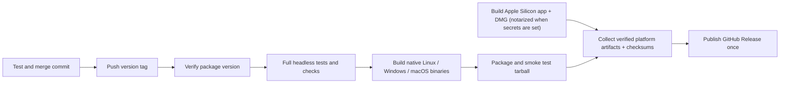

# Releases

Releases include Linux x86_64 tarballs, Windows x64 installers and an Apple
Silicon (arm64) macOS DMG.
The binary uses the existing release profile: full LTO, one codegen unit,
and stripped symbols. Packaging adds no startup work.

## Install

Download the tarball from the repository's GitHub Releases page, extract it,
and install the binary:

```sh
tar -xzf mdview-v0.1.1-linux-x86_64.tar.gz
install -Dm755 mdview-v0.1.1-linux-x86_64/mdview ~/.local/bin/mdview
mdview README.md
```

Make sure `~/.local/bin` is on your `PATH`. The archive also contains the
README, this guide and the application icon. SHA-256 checksums are attached as `SHA256SUMS`; compare them with
`sha256sum` before installing.

The binary is built on Ubuntu 22.04 with glibc 2.35. Use a compatible Linux
x86_64 distribution with glibc 2.35 or newer. It requires X11 or Wayland,
libxkbcommon (including its X11 library), libxcb, fontconfig, freetype,
a Vulkan loader and a working GPU driver. For the file picker, install
xdg-desktop-portal and a suitable backend. On Ubuntu:

```sh
sudo apt-get install libxkbcommon0 libxkbcommon-x11-0 libxcb1 libwayland-client0 libwayland-cursor0 libwayland-egl1 libfontconfig1 libfreetype6 libvulkan1 xdg-desktop-portal xdg-desktop-portal-gtk
```

Install the Vulkan driver appropriate for your GPU as described in the
contributing guide. The tarball does not bundle system libraries or drivers.

## Publish

Before tagging, test the intended commit, update the package version in
Cargo.toml and Cargo.lock, and merge the changes to main. A release is an
explicit maintainer action; ordinary pushes do not publish anything.

```sh
git switch main
git pull --ff-only
git tag -a v0.1.1 -m 'mdview v0.1.1'
git push origin v0.1.1
```

Use the next version for subsequent releases. Never move a published tag.
The release workflow rejects tags that do not match the app package version.
It runs formatting, guards, clippy and the full headless workspace test suite
using the CI profile, then builds the Linux release binary, packages it,
checks the extracted binary's help output and shared libraries, and uploads the verified tarball. A final job collects all enabled platform
artifacts and publishes one GitHub Release with checksums and generated notes. Real window
tests remain local only. There is no draft stage. A failed test or build does
not publish a release; fix the cause before rerunning the workflow.



## Windows

Run the Windows x64 `setup.exe` asset. It installs for the current user without
administrator privileges, creates a Start menu entry and supports uninstall
through Windows Settings. Optional tasks add a desktop shortcut and Open with
registration for Markdown extensions; they do not replace the default viewer.
The application uses Direct3D 11 and requires Windows 10 version 1809 or newer
and a compatible graphics driver. Native GPU testing on the minimum OS remains
required before claiming that minimum as verified.

The installer is currently unsigned; Windows may show an unknown-publisher or
SmartScreen prompt. Authenticode credentials are needed to sign production
Windows releases. Install/upgrade/uninstall and installed `--help` are smoke
tested in native CI. This does not replace interactive GPU testing.

Local packaging (PowerShell, after building):

```powershell
& "${env:ProgramFiles(x86)}/Inno Setup 6/ISCC.exe" /DAppVersion=0.1.1 "/DSourceDir=$PWD/target/release" packaging/windows/mdview.iss
```

## macOS

Open the arm64 DMG and drag mdview into Applications. The app runs natively
on Apple Silicon; Intel Macs are not supported. The build targets
macOS 13 or newer; verify minimum-OS GPU behavior on real hardware before
calling that minimum tested. Finder Open with, file drops and CLI launches
open Markdown tabs. The application stays running after its last window is
closed; the Dock recreates a window and Command+Q quits.

The CLI remains available inside the bundle:

```sh
/Applications/mdview.app/Contents/MacOS/mdview README.md
```

Tagged macOS releases are Developer ID signed and notarized when these
repository Actions secrets are configured:
`MACOS_CERTIFICATE_BASE64` (Developer ID Application P12),
`MACOS_CERTIFICATE_PASSWORD`, `MACOS_SIGN_IDENTITY`, `APPLE_ID`,
`APPLE_TEAM_ID`, and `APPLE_APP_PASSWORD` (an app-specific password).
Credentials are imported into a temporary keychain that is removed afterward.
If the certificate secret is set but any other credential is missing, the
macOS job fails and nothing is published. If no signing secrets are
configured, the release ships an ad-hoc-signed, unnotarized DMG and the
workflow emits a warning. PR CI always builds an ad-hoc-signed DMG for
packaging tests.

Unnotarized DMGs are blocked by Gatekeeper on first launch. After copying
mdview to Applications, either right-click it and choose Open (on macOS 15,
allow it under System Settings → Privacy & Security), or remove the
quarantine attribute:

```sh
xattr -dr com.apple.quarantine /Applications/mdview.app
```

`packaging/macos/package.sh VERSION` packages the optimized arm64 target build,
creates the app icon and bundle, verifies the arm64 architecture, builds and mounts
the DMG, verifies its signature, and runs the packaged binary's help. A signed
release also notarizes/staples the DMG and checks Gatekeeper assessment. For
local signing, set `MACOS_SIGN_IDENTITY` and store a `mdview-notary` profile
using `xcrun notarytool store-credentials` first.
