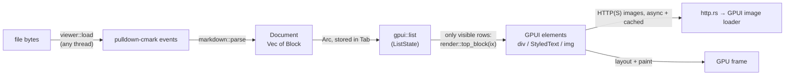
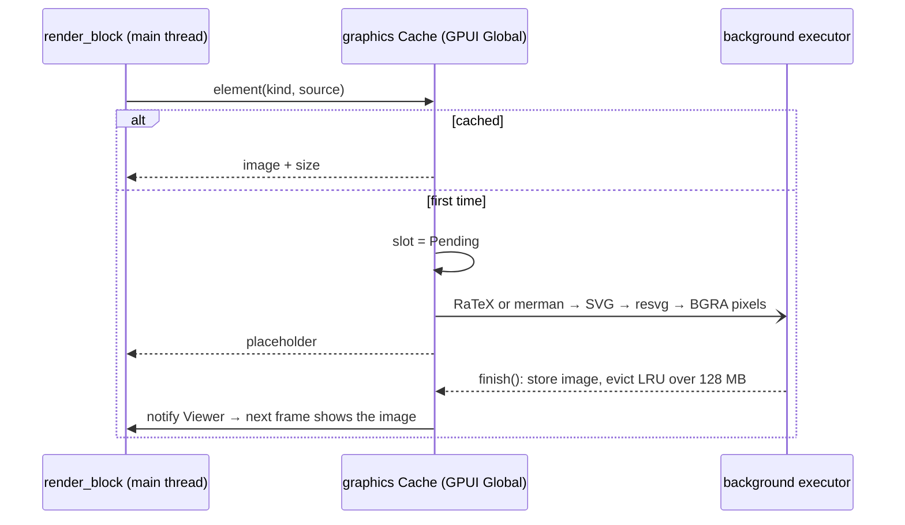

# Rendering pipeline

How a `.md` file becomes pixels, and how to change or extend that.

## Overview



Parsing happens **once per load**. Frames never look at the raw Markdown again,
so scrolling only re-renders the rows that are visible.

## 1. Parsing (`crates/mdview-core/src/markdown.rs`)

`parse()` collects every pulldown-cmark event into a `Vec` and walks it with a
small recursive-descent parser (`struct P`):

- `blocks()` reads block-level events until the matching `End`. Inline events
  that show up at block level become an implicit paragraph. That happens in
  "tight" list items, which pulldown-cmark emits without a `Paragraph` tag.
- `inlines()` reads inline events and flattens them into one `RichText`. It
  tracks bold, italic and strikethrough with nesting counters, plus the current
  link. Each piece of text is appended as a span with the current style;
  `RichText::push` merges it with the previous span when the style matches.
  The result is non-overlapping spans that cover the whole text.
- Task-list markers are lifted onto `ListItem::checked`. That works for tight
  items (`Item, TaskListMarker`) and loose items
  (`Item, Paragraph, TaskListMarker`).
- A paragraph made only of images becomes `Block::Images`. In any other
  paragraph, an image appears inline as `[alt]` and links to the image.
- HTML blocks and front matter (YAML `---` or TOML `+++`) are skipped.
- Fenced code blocks are highlighted here, once, by `highlight::highlight`
  (see [Syntax highlighting](#syntax-highlighting)).
- Inline math (`$…$`) is converted to Unicode text by `latex::to_unicode`
  and pushed into the `RichText`, with variables in italics. Display math
  (`$$…$$`) splits its paragraph: the text before and after become
  paragraphs, and the formula becomes a `Block::Math`. A ```` ```math ````
  code block becomes a `Block::Math` too. See [Math](#math).
- A ```` ```mermaid ```` code block becomes a `Block::Mermaid`. See
  [Mermaid diagrams](#mermaid-diagrams).

Enabled extensions: tables, strikethrough, task lists, footnotes, GFM alerts
(`> [!NOTE]` and friends), metadata blocks, and math (`$…$` / `$$…$$`, with
GitHub's rules, so `$5 and $10` stays text).

## 2. Virtualization (`src/viewer.rs`)

Each `Tab` owns a `gpui::ListState`, created with
`ListState::new(blocks.len(), ListAlignment::Top, px(800.))`:

- **One list row = one top-level `Block`.** A huge table or code block is
  still a single row, so very large blocks are the one case that virtualization
  doesn't help.
- The list measures rows lazily and caches their heights. `800px` of overdraw
  keeps rows just outside the viewport ready, so scrolling stays smooth.
- When a file is reloaded, `ListState::reset` is called and the old scroll
  position is put back (`Tab::replace`).

## 3. Elements (`src/render.rs`)

`top_block(block, ix, rcx)` wraps each row in a centered column, at most
`CONTENT_MAX_WIDTH` (880 px) wide. `render_block` then handles the different
block kinds. Everything it needs comes from `RenderCx`, which is cheap to
clone:

| Field | Purpose |
| --- | --- |
| `theme` | Colors for the current light or dark appearance |
| `ui_font`, `mono_font` | Font families picked at startup (`pick_fonts` in `main.rs`) |
| `base_dir` | The document's folder, used to resolve relative links and images |
| `viewer` | `WeakEntity<Viewer>`, so clicking a link can open tabs or scroll |

### Text with inline styles

GPUI's `HighlightStyle` can't change the font family, and inline code needs
the monospace font. So `rich_text()` builds explicit `TextRun`s instead (each
run has its own `Font`, color, background, underline and strikethrough), then
calls `StyledText::with_runs`. If the text contains links, it's wrapped in
`InteractiveText` with one clickable range per link span.

`InteractiveText` needs an `ElementId` that's unique within the row.
`IdGen(ix * 100_000)` generates them: row `ix` gets ids starting at
`ix * 100_000 + 1`. Code blocks also take ids from it, because horizontal
scrolling needs one.

### Syntax highlighting

`crates/mdview-core/src/highlight.rs` is a set of small hand-written lexers, not a grammar
engine: a generic lexer configured per language (keywords, types, comment and
string syntax, and a few flags such as "capitalized words are types"), plus
line-based lexers for shell sessions, diffs, HTML/XML and YAML/TOML/INI. It
returns sorted `Highlight { range, tok }` spans, which `render::code_text`
turns into `TextRun`s colored by `Theme::token`.

It runs inside `markdown::parse`, so code is already colored in the first frame
and nothing is loaded at startup. Lexing takes microseconds per block. That's
why it doesn't use `syntect` (loading its syntax set takes tens of
milliseconds) or tree-sitter (large grammars, slow to build).

To support a new language, add a `Lang` to `lang_def` (or an alias to an
existing one) and a test in `highlight::tests`. Unknown languages are shown
uncolored.

### Markdown images

Standalone local images resolve relative to the document folder. HTTP(S)
images use GPUI's asynchronous image loader and asset cache. `http.rs` adapts
GPUI's existing reqwest dependency, with TLS verification, redirects (up to
10 hops), and a 30-second timeout. Client creation and downloads run on smol's
blocking pool only when requested; startup never waits for the network.
Images scale down to fit the column and show alt text on failure. Other URI
schemes remain links. Images mixed into a text paragraph remain alt-text links.

### Math

Inline and display math are handled differently, because GPUI lays out a
paragraph as a single run of text and can't put an image inside it.

- **Inline** `$…$` is turned into text while parsing (`crates/mdview-core/src/latex.rs`): Greek
  letters and symbols become Unicode characters, `x^2` becomes `x²` (or
  `x^(…)` when there's no superscript character), `\frac{a}{b}` becomes
  `a/b`, `\mathbb{R}` becomes `ℝ`, and variables are italic. It isn't a
  typesetter, but common inline math reads well and wraps with the text.
- **Display** `$$…$$` and ```` ```math ```` blocks are typeset for real by
  RaTeX, a Rust port of KaTeX that embeds the KaTeX fonts, so formulas look
  like they do on GitHub. Glyphs are emitted as SVG paths, so no font lookup
  is needed. See [Images rendered in the background](#images-rendered-in-the-background).

### Mermaid diagrams

```` ```mermaid ```` blocks are laid out and drawn to SVG by
[merman](https://github.com/Latias94/merman), a headless Rust implementation
of Mermaid that aims for parity with mermaid.js (Zed uses it too). All
diagram families are enabled except the ELK layout engine.

- **Theme.** Mermaid's `base` theme, with colors taken from `Theme`
  (`mermaid_config`), so diagrams match the light or dark palette.
- **Fonts.** Labels use the UI font. merman measures them with that very font
  (its `native-fonts` feature, fed with the UI font's regular and bold faces);
  with its built-in metrics, which assume "trebuchet ms", wider fonts would
  overflow their boxes. The system font database for resvg is loaded once, on
  a background thread, the first time a diagram is drawn (~10–15 ms), with
  `sans-serif` mapped to the UI font. Missing characters (say `→` in Noto
  Sans) fall back to a proportional font of the same style
  (`fallback_font`), not to whatever face comes first.
- **Size.** Diagrams are shown at their natural size, centered, and scaled
  down to the column width when wider, like on GitHub.

### Images rendered in the background

Display math and diagrams go through the same pipeline in
`src/graphics.rs`:



The image is rasterized at the window's scale factor (capped at 4096 px per
side) and shown at its logical size.

The cache key is the kind, the source, light/dark, and the scale factor, so
switching tabs or reloading an unchanged file never re-renders. Old entries
are evicted (and their GPU textures dropped with `cx.drop_image`) once the
cached pixels exceed 128 MB, which matters when live-reloading a file while
editing it.

If a formula or diagram can't be parsed, the block shows the error and the
source. The renderers are third-party code fed with arbitrary input, so
their panics are caught with `catch_unwind` (that's why the release profile
uses `panic = "unwind"`) and shown the same way.

### Typography

| Setting | Value |
| --- | --- |
| Base size / line height | 16 px / 1.6 |
| H1 … H6 | 2.0, 1.5, 1.25, 1.0, 0.875, 0.85 em. H1–H2 are bold with a bottom border; H3–H6 are semibold. |
| Code blocks | 13.5 px monospace, line height 1.5, scroll horizontally, no wrapping |
| Content width | max 880 px, 32 px side padding |

### Fonts

`pick_fonts` selects from a short list of advertised families. On macOS,
Helvetica Neue follows Inter and IBM Plex Sans, ahead of Linux fallback names.
GPUI advertises some fallback names even when the family is not installed;
picking those on macOS can fall back to regular Helvetica and lose bold/italic
styles. Native macOS font priority avoids that fallback. Linux order is unchanged.

The remaining preference lists are:

- UI: `Inter`, `IBM Plex Sans`, `Noto Sans`, `Cantarell`, `DejaVu Sans`,
  `Liberation Sans`, `Segoe UI`, `Helvetica Neue`, `Helvetica` (with the macOS
  priority exception above)
- Monospace: `JetBrains Mono`, `Lilex`, `Fira Code`, `Noto Sans Mono`,
  `DejaVu Sans Mono`, `Liberation Mono`, `Consolas`, `Menlo`, `Monaco`

`MDVIEW_FONT` and `MDVIEW_MONO_FONT` override these. Don't ask fontconfig at
runtime (for example by running `fc-match`), because it costs startup time.

### Theme (`src/theme.rs`)

There are two hard-coded palettes, based on Zed's One Dark and One Light. The
`Viewer` subscribes to `observe_window_appearance`, so switching the system
between light and dark redraws the window right away.

## How to add support for new syntax

Example: definition lists (`Options::ENABLE_DEFINITION_LIST`).

1. **Model.** Add a variant to `Block` in `markdown.rs`. Keep it plain data
   (`String`, `RichText`, `Vec<Block>`), with no GPUI types.
2. **Parser.** Enable the option in `parse()`. Handle the new `Tag` in
   `P::block()`, and the `TagEnd` if it's inline (`is_inline`).
3. **Test.** Extend `tests::parses_basic_document` or add a new test next to
   it. Run `cargo test`.
4. **Render.** Add an arm to `render_block` in `render.rs`. Use `rich_text()`
   for any text, so links and inline styles keep working.
5. **Look at it.** Add a sample to `examples/demo.md` and open it
   (`./target/release/mdview -n examples/demo.md`) in both light and dark mode.
6. **Docs.** Update the class diagram in [architecture.md](architecture.md) if
   `Block` changed.

## Known gaps

These are tracked in [roadmap.md](roadmap.md#rendering): raw
HTML, text selection, and real typesetting for inline math.
