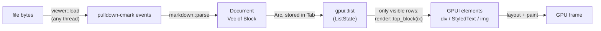

# Rendering pipeline

How a `.md` file becomes pixels, and how to change or extend that.

## Overview

Parsing happens **once per load**. Frames never look at the raw Markdown again,
so scrolling only re-renders the rows that are visible.

## 1. Parsing (`src/markdown.rs`)

`parse()` collects every pulldown-cmark event into a `Vec` and walks it with a
small recursive-descent parser (`struct P`):

- `blocks()` reads block-level events until the matching `End`. Inline events
  that show up at block level become an implicit paragraph. That happens in
  "tight" list items, which pulldown-cmark emits without a `Paragraph` tag.
- `inlines()` reads inline events and flattens them into one `RichText`. It
  tracks bold, italic and strikethrough with nesting counters, plus the current
  link. Each piece of text is appended as a span with the current style;
  `RichText::push` merges it with the previous span when the style matches.
  The result is non-overlapping spans that cover the whole text.
- Task-list markers are lifted onto `ListItem::checked`. That works for tight
  items (`Item, TaskListMarker`) and loose items
  (`Item, Paragraph, TaskListMarker`).
- A paragraph made only of images becomes `Block::Images`. In any other
  paragraph, an image appears inline as `[alt]` and links to the image.
- HTML blocks and front matter (YAML `---` or TOML `+++`) are skipped.

Enabled extensions: tables, strikethrough, task lists, footnotes, GFM alerts
(`> [!NOTE]` and friends), and metadata blocks.

## 2. Virtualization (`src/viewer.rs`)

Each `Tab` owns a `gpui::ListState`, created with
`ListState::new(blocks.len(), ListAlignment::Top, px(800.))`:

- **One list row = one top-level `Block`.** A huge table or code block is
  still a single row, so very large blocks are the one case that virtualization
  doesn't help.
- The list measures rows lazily and caches their heights. `800px` of overdraw
  keeps rows just outside the viewport ready, so scrolling stays smooth.
- When a file is reloaded, `ListState::reset` is called and the old scroll
  position is put back (`Tab::replace`).

## 3. Elements (`src/render.rs`)

`top_block(block, ix, rcx)` wraps each row in a centered column, at most
`CONTENT_MAX_WIDTH` (880 px) wide. `render_block` then handles the different
block kinds. Everything it needs comes from `RenderCx`, which is cheap to
clone:

| Field | Purpose |
| --- | --- |
| `theme` | Colors for the current light or dark appearance |
| `ui_font`, `mono_font` | Font families picked at startup (`pick_fonts` in `main.rs`) |
| `base_dir` | The document's folder, used to resolve relative links and images |
| `viewer` | `WeakEntity<Viewer>`, so clicking a link can open tabs or scroll |

### Text with inline styles

GPUI's `HighlightStyle` can't change the font family, and inline code needs
the monospace font. So `rich_text()` builds explicit `TextRun`s instead (each
run has its own `Font`, color, background, underline and strikethrough), then
calls `StyledText::with_runs`. If the text contains links, it's wrapped in
`InteractiveText` with one clickable range per link span.

`InteractiveText` needs an `ElementId` that's unique within the row.
`IdGen(ix * 100_000)` generates them: row `ix` gets ids starting at
`ix * 100_000 + 1`. Code blocks also take ids from it, because horizontal
scrolling needs one.

### Typography

| Setting | Value |
| --- | --- |
| Base size / line height | 16 px / 1.6 |
| H1 … H6 | 2.0, 1.5, 1.25, 1.0, 0.875, 0.85 em. H1–H2 are bold with a bottom border; H3–H6 are semibold. |
| Code blocks | 13.5 px monospace, line height 1.5, scroll horizontally, no wrapping |
| Content width | max 880 px, 32 px side padding |

### Fonts

`pick_fonts` uses the first installed family from a short list:

- UI: `Inter`, `IBM Plex Sans`, `Noto Sans`, `Cantarell`, `DejaVu Sans`,
  `Liberation Sans`
- Monospace: `JetBrains Mono`, `Lilex`, `Fira Code`, `Noto Sans Mono`,
  `DejaVu Sans Mono`, `Liberation Mono`

`MDVIEW_FONT` and `MDVIEW_MONO_FONT` override these. Don't ask fontconfig at
runtime (for example by running `fc-match`), because it costs startup time.

### Theme (`src/theme.rs`)

There are two hard-coded palettes, based on Zed's One Dark and One Light. The
`Viewer` subscribes to `observe_window_appearance`, so switching the system
between light and dark redraws the window right away.

## How to add support for new syntax

Example: definition lists (`Options::ENABLE_DEFINITION_LIST`).

1. **Model.** Add a variant to `Block` in `markdown.rs`. Keep it plain data
   (`String`, `RichText`, `Vec<Block>`), with no GPUI types.
2. **Parser.** Enable the option in `parse()`. Handle the new `Tag` in
   `P::block()`, and the `TagEnd` if it's inline (`is_inline`).
3. **Test.** Extend `tests::parses_basic_document` or add a new test next to
   it. Run `cargo test`.
4. **Render.** Add an arm to `render_block` in `render.rs`. Use `rich_text()`
   for any text, so links and inline styles keep working.
5. **Look at it.** Add a sample to `examples/demo.md` and open it
   (`./target/release/mdview -n examples/demo.md`) in both light and dark mode.
6. **Docs.** Update the class diagram in [architecture.md](architecture.md) if
   `Block` changed.

## Known gaps

These are tracked in [roadmap.md](roadmap.md#rendering): remote images, raw
HTML, syntax highlighting, text selection, Mermaid and math rendering.
