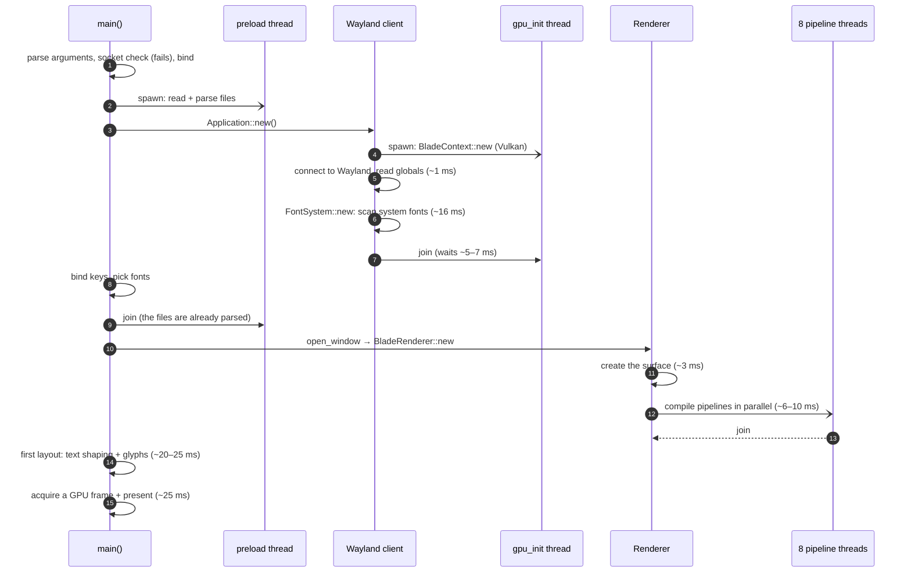
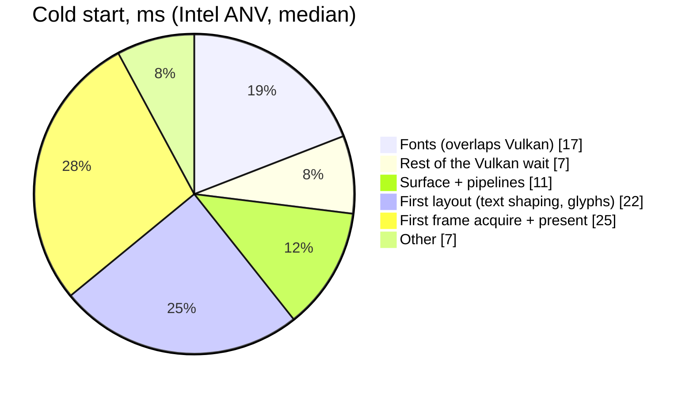

# Startup performance

Startup time is the project's top priority. This page explains where the time
goes, what has already been optimized, and how to measure it.

## Two paths

| Path | When | Typical time |
| --- | --- | --- |
| **Warm** | An mdview window is already running | **~4 ms**: connect to the socket, send the paths, exit |
| **Cold** | No instance is running | **~89 ms** to the first frame presented on an Intel Iris Xe (ANV) |

The warm path skips GPUI, Vulkan, the display connection and fonts entirely,
which is why it's so much faster. Don't add work before the socket check in
`main()`.

The warm path still pays for loading the executable, and that grows with the
binary: the dynamic loader applies every relocation and the kernel maps every
page it touches. Adding RaTeX and merman (math and Mermaid) took the binary
from ~15 to ~38 MB and the relocations from ~25k to ~61k, which made
`mdview --help` (process start to exit, nothing else) go from 1.50 to 1.97 ms
median. Cold start didn't change measurably. Keep an eye on this when adding
dependencies.

## Cold start, step by step



Breakdown of the ~89 ms median (ANV):



## History of the optimizations

| Change | Where | Effect (ANV) | Effect (lavapipe) |
| --- | --- | --- | --- |
| Single instance over a Unix socket | `src/main.rs` | later launches take ~4 ms | same |
| Parse files on a thread while GPUI starts | `src/main.rs` | parsing is off the critical path | same |
| Virtualized list (`gpui::list`) | `src/viewer.rs` | first frame lays out only the visible blocks | same |
| Don't build the pipelines twice | `crates/gpui` (fix 1) | −11 ms | −30 ms |
| Compile the pipelines in parallel | `crates/gpui` (fix 2) | 12 → 7 ms | 34 → 19 ms |
| Run Vulkan init alongside font loading | `crates/gpui` (fix 3) | 33 → 29 ms until the platform is ready | 51 → 40 ms |
| **Total (cold start)** | | **~105 → ~89 ms** | **~159 → ~103 ms** |

Medians of 15 runs (ANV) and 8 runs (lavapipe), timed from `main()` to the
first presented frame. See [gpui-fork.md](gpui-fork.md) for details on the
GPUI fixes.

## How to measure

### Quick: time to the first frame

```sh
cargo build --release
MDVIEW_TRACE_STARTUP=1 ./target/release/mdview -n examples/demo.md
# prints: first frame: 85.3ms
MDVIEW_TRACE_STARTUP=quit ./target/release/mdview -n examples/demo.md   # also exits right away
```

- Always pass `-n`. Without it, if a window is already open you only measure
  the warm path.
- This mark fires when GPUI calls `on_next_frame`, which is just *before* the
  GPU submits the frame. The detailed method below also counts the present.
- Run it several times and compare **medians**. The first run after a build is
  slower because of cold disk and shader caches.

### Detailed: time per phase

Detailed timing needs temporary marks inside GPUI. **Never commit them.**
Work on a copy outside the repo:

```sh
mkdir -p /tmp/mdview-prof
cp -r Cargo.toml Cargo.lock src examples crates /tmp/mdview-prof/
cd /tmp/mdview-prof
# Faster to rebuild than full LTO:
sed -i 's/^lto = "fat"/lto = false/; s/^codegen-units = 1/codegen-units = 16/' Cargo.toml
```

Add a helper to `crates/gpui/src/gpui.rs`:

```rust
#[doc(hidden)]
pub fn tmark(l: &str) {
    let us = std::time::SystemTime::now()
        .duration_since(std::time::UNIX_EPOCH).unwrap().as_micros();
    eprintln!("TMARK {us} {l}");
}
```

Then call `crate::tmark("label")` (or `gpui::tmark` from `src/`) at the points
you care about. Useful places:

| File | Point |
| --- | --- |
| `platform/linux/wayland/client.rs` `WaylandClient::new` | before/after `LinuxCommon::new` (fonts), after the GPU `join` |
| `platform/blade/blade_renderer.rs` `BladeRenderer::new` | after the surface, after `BladePipelines::new` |
| `window.rs` `Window::new` | around `request_decorations` … `map_window` |
| `app.rs` `open_window` | around `window.draw(cx)` |
| `platform/blade/blade_renderer.rs` `draw` | after `gpu.submit` (first call only) |

Print relative times with:

```sh
./target/release/mdview -n examples/demo.md 2>&1 | awk '/^TMARK/ {
  if (!t0) {t0=$2; p=$2}
  printf "%7.1f ms (+%5.1f) %s\n", ($2-t0)/1000, ($2-p)/1000, substr($0, index($0,$3)); p=$2 }'
```

To compare against the software renderer:
`VK_ICD_FILENAMES=/usr/share/vulkan/icd.d/lvp_icd.json`.

## Notes for users

- **Install the right Vulkan driver.** On Intel that's `vulkan-intel`; on AMD,
  `vulkan-radeon`. Without it, GPUI falls back to lavapipe (software
  rendering), which is about 15–50% slower to start and much slower to scroll.
- **Compositor animations.** niri, GNOME, KDE and others animate new windows.
  The animation often takes longer than mdview's whole startup. In niri you can
  turn it off with `animations { window-open { off; } }`.

## Ideas not done yet

See [roadmap.md](roadmap.md#startup). The largest remaining costs are the
first layout (~22 ms) and the first frame present (~25 ms), which seems to be
mostly waiting on the compositor. The next idea to try is warming up the main
font's glyphs while Vulkan initializes.
