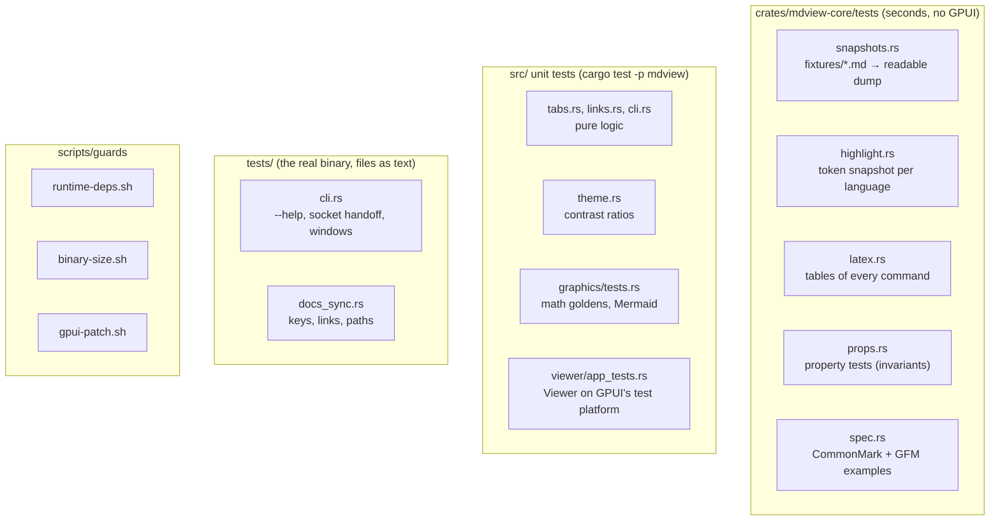

# Testing

mdview is changed by people and by AI agents. The tests exist so that a
change that breaks something, or changes behavior by accident, fails before it
is committed. This page explains what is tested where, how to run it, and how
to update expected outputs when a change is intended.

## The one command

```sh
scripts/check.sh            # fmt, guards, clippy -D warnings, all workspace tests
scripts/check.sh --quick    # fmt, guards, clippy, core + docs tests (the pre-commit hook)
scripts/check.sh --release  # also build the release binary and check its size
scripts/check.sh --e2e      # also run the window tests (opens windows for a moment)
scripts/check.sh --bless    # accept intentional guard changes (see below)
scripts/install-hooks.sh    # install the pre-commit hook (runs check.sh --quick)
```

`scripts/check.sh` must pass before every commit. It stops at the first failing
step and says how to fix it. CI (`.github/workflows/ci.yml`) runs the same
script on every pull request.

## What is tested where



| Layer | Where | What it catches |
| --- | --- | --- |
| Parser snapshots | `crates/mdview-core/tests/snapshots.rs`, `fixtures/*.md` | Any change in the block model: text, inline styles, links, slugs, tables, lists, callouts, math, front matter |
| Highlighter | `crates/mdview-core/tests/highlight.rs`, `code/*.txt` | Token changes for every language; a new language without a sample |
| Inline LaTeX | `crates/mdview-core/tests/latex.rs` | The Unicode output of every symbol, function, accent and structure |
| Properties | `crates/mdview-core/tests/props.rs` | Panics and broken invariants on generated input: spans inside the text, on char boundaries, sorted, non-overlapping; valid link indices; highlight ranges for every language; LaTeX italic ranges |
| Spec examples | `crates/mdview-core/tests/spec.rs`, `data/` | The same invariants on all CommonMark 0.31.2 and GFM examples, plus block counts against the spec's HTML |
| Pure app logic | `src/tabs.rs`, `src/links.rs`, `src/cli.rs` | Tab dedupe and active tab after closing; link routing and percent decoding; argument parsing and the socket message format |
| Theme | `src/theme.rs` | Contrast of every color on its background in both themes (see [Theme contrast](#theme-contrast)) |
| Graphics | `src/graphics/tests.rs`, `tests/golden/math/` | Display math against golden images; Mermaid diagrams render, aren't blank and stay under the size limit; bad input gives an error, not a panic |
| Viewer | `src/viewer/app_tests.rs` | Tabs, actions, live reload (on a fake clock), scrolling, anchors, link clicks, and drawing every example document in light and dark |
| Binary | `tests/cli.rs` | `--help`, the warm path (paths sent to a running instance), stale sockets; with `MDVIEW_E2E=1`, real windows for every example and odd inputs |
| Docs | `tests/docs_sync.rs` | Key bindings missing from the README or `--help`, broken links and anchors, paths that no longer exist |
| Guards | `scripts/guards/` | New runtime dependencies, binary growth over 3%, `crates/gpui` out of sync with its patch |

The core crate has its own guide with more detail:
[crates/mdview-core/tests/README.md](../crates/mdview-core/tests/README.md).

## When a change is intended

Expected outputs are recorded in files. When you change behavior on purpose,
update them, then **read the diff**: a snapshot records what the code
*should* do, so accepting one blindly turns a bug into the expected result.

| What changed | How to update |
| --- | --- |
| Parser, highlighter or LaTeX output | `cargo insta test -p mdview-core --review` (or `INSTA_UPDATE=always cargo test -p mdview-core`, then `git diff`) |
| Display math images | `UPDATE_GOLDEN=1 cargo test -p mdview graphics`, then look at the changed PNGs in `tests/golden/math/`. On a failure, the actual image and a diff are written to `target/golden-failures/math/` |
| Runtime dependencies or the GPUI patch | `scripts/check.sh --bless`, with startup numbers in the commit message |
| Binary size | `scripts/check.sh --release --bless`, with startup numbers in the commit message |
| A theme color | Update the pinned contrast value in `src/theme.rs` |

## Rules for changes

- **Bug fixes start with a test** that fails without the fix. Commit the test
  with the fix.
- **New features come with tests.** New syntax gets a fixture in
  `crates/mdview-core/tests/fixtures/`. A new highlighter language gets a
  sample in `code/` and an entry in `common/langs.rs` (a test fails
  otherwise). New app logic goes in a pure function or type with unit tests,
  as in `tabs.rs` or `links.rs`, not only inside a GPUI view.
- **Don't weaken a test to make it pass.** Don't delete a test, loosen an
  assertion, or bless a snapshot without explaining why in the commit message.
- **Proptest failures are saved** in `props.proptest-regressions` next to
  `props.rs`. Commit that file with the fix.

## Theme contrast

`src/theme.rs` checks the WCAG contrast ratio of each color on the background
it's drawn on. Goals: 4.5 for text and syntax tokens, 3.0 for muted text,
callout titles and UI marks. Some colors from Zed's One Light/Dark palettes
fall short today (several light-theme syntax tokens, the light link color,
light muted text on hover). They're pinned at their current value with a
`TODO(contrast)` note. The test fails if one gets worse, and also when one
starts meeting its goal, so the pin gets removed.

## Window tests

`tests/cli.rs` never opens a window by default. With `MDVIEW_E2E=1` and a
display, it runs `MDVIEW_TRACE_STARTUP=quit mdview -n` on every file in
`examples/` and on odd inputs (empty, binary, missing, a directory, an 8 MB
file), and checks a real single-instance handoff:

```sh
MDVIEW_E2E=1 cargo test --test cli      # or: scripts/check.sh --e2e
```

## Deeper checks (not run on every commit)

**Mutation testing** changes the code (for example `<` to `<=`, or a function
body to a default value) and checks that some test fails. A change that no
test notices shows untested logic.

```sh
# cargo-mutants copies the tree into $TMPDIR. If /tmp is a tmpfs (RAM),
# point it at the disk.
export TMPDIR=~/.cache/mdview-mutants/tmp; mkdir -p "$TMPDIR"
# Some mutants turn a lexer loop into one that never advances and keeps
# allocating (e.g. `number_end` returning 0): gigabytes in seconds, long
# before the timeout. Cap each process so they fail fast (and count as
# caught) instead of taking the machine down.
(ulimit -v 2500000; cargo mutants -p mdview-core --test-package mdview-core -j 2)
(ulimit -v 6000000; cargo mutants -p mdview -f src/tabs.rs -f src/links.rs -f src/cli.rs -j 1)
```

Don't use `--in-place` in your working tree. If it is interrupted, the
mutated source is left behind. CI runs the core crate weekly and uploads
`mutants.out`.

**Coverage:** `cargo llvm-cov -p mdview-core --html` (the report goes to
`target/llvm-cov/html`).

**Fuzzing:** three libFuzzer targets (`parse`, `highlight`, `latex`) check
the same invariants as the property tests. See
[fuzz/README.md](../fuzz/README.md).

**Startup:** `scripts/startup-bench.sh --ref origin/main` builds `main` in a
worktree outside the repo and compares it with `./target/release/mdview`.
`scripts/startup-bench.sh OLD NEW` compares two binaries. The output can be
pasted into a commit message. See [startup.md](startup.md).

## CI

`.github/workflows/ci.yml` runs on pushes to `main` and on pull requests:

- `scripts/check.sh` with GPUI's system libraries;
- the GPUI patch guard on its own;
- the window tests under Xvfb with Mesa's software Vulkan (lavapipe). This job
  is `continue-on-error` until it has been seen to pass on GitHub's runners;
- weekly (and on demand): mutation testing of `mdview-core`.
