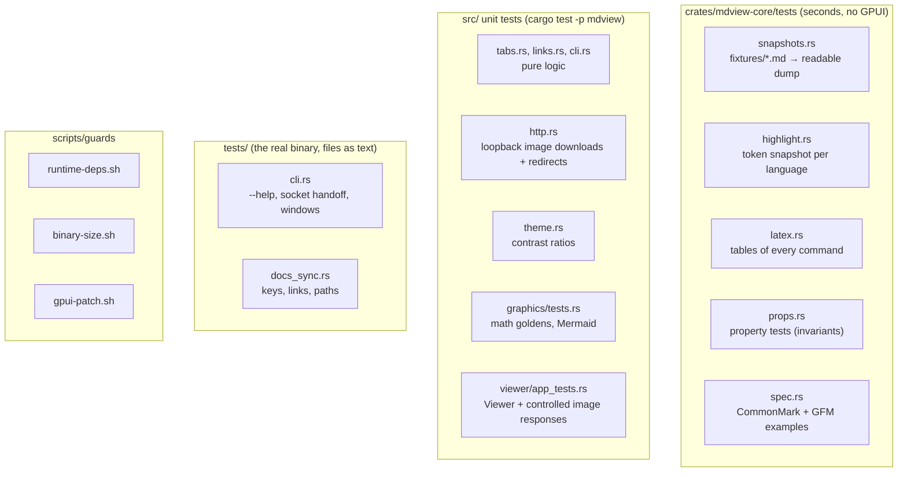

# Testing

mdview is changed by people and by AI agents. The tests exist so that a
change that breaks something, or changes behavior by accident, fails before it
is committed. This page explains what is tested where, how to run it, and how
to update expected outputs when a change is intended.

## The one command

```sh
scripts/check.sh            # fmt, guards, clippy -D warnings, all workspace tests
scripts/check.sh --quick    # fmt, guards, clippy, core + docs tests (the pre-commit hook)
scripts/check.sh --release  # also build the release binary and check its size
scripts/check.sh --e2e      # also run the window tests (opens windows for a moment)
scripts/check.sh --bless    # accept intentional guard changes (see below)
scripts/install-hooks.sh    # install the pre-commit hook (runs check.sh --quick)
```

`scripts/check.sh` must pass before every commit. It stops at the first failing
step and says how to fix it. CI (`.github/workflows/ci.yml`) runs the same
script on every pull request.

## What is tested where



| Layer | Where | What it catches |
| --- | --- | --- |
| Parser snapshots | `crates/mdview-core/tests/snapshots.rs`, `fixtures/*.md` | Any change in the block model: text, inline styles, links, slugs, tables, lists, callouts, math, front matter |
| Highlighter | `crates/mdview-core/tests/highlight.rs`, `code/*.txt` | Token changes for every language; a new language without a sample |
| Inline LaTeX | `crates/mdview-core/tests/latex.rs` | The Unicode output of every symbol, function, accent and structure |
| Properties | `crates/mdview-core/tests/props.rs` | Panics and broken invariants on generated input: spans inside the text, on char boundaries, sorted, non-overlapping; valid link indices; highlight ranges for every language; LaTeX italic ranges |
| Spec examples | `crates/mdview-core/tests/spec.rs`, `data/` | The same invariants on all CommonMark 0.31.2 and GFM examples, plus block counts against the spec's HTML |
| Pure app logic | `src/tabs.rs`, `src/links.rs`, `src/cli.rs` | Tab dedupe and active tab after closing; link routing and percent decoding; argument parsing and the socket message format |
| Image HTTP | `src/http.rs`, `src/viewer/app_tests.rs` | Loopback downloads, redirects and HTTP errors; FakeHttpClient Viewer tests for URL requests, malformed bytes, delayed loading with usable scrolling/tabs, and completion after tab/window closure |
| Theme | `src/theme.rs` | Contrast of every color on its background in both themes (see [Theme contrast](#theme-contrast)) |
| Graphics | `src/graphics/tests.rs`, `tests/golden/math/` | Display math against golden images; Mermaid diagrams render, aren't blank and stay under the size limit; bad input gives an error, not a panic |
| Viewer | `src/viewer/app_tests.rs` | Tabs, actions, live reload (on a fake clock), scrolling, anchors, link clicks, and drawing every example document in light and dark |
| Binary | `tests/cli.rs` | `--help`, the warm path (paths sent to a running instance), stale sockets; with `MDVIEW_E2E=1`, real windows for every example and odd inputs |
| Docs | `tests/docs_sync.rs` | Key bindings missing from the README or `--help`, broken links and anchors, paths that no longer exist |
| Guards | `scripts/guards/` | New runtime dependencies, binary growth over 3%, `crates/gpui` out of sync with its patch |

The core crate has its own guide with more detail:
[crates/mdview-core/tests/README.md](../crates/mdview-core/tests/README.md).

The focused image lifecycle tests hold `FakeHttpClient` responses on a one-shot
channel and explicitly release them, then drain GPUI's test executor. They
assert pending/error/success in the image cache and exercise Viewer actions
while pending and after completion, without sleeps or external network. These
headless tests check lifecycle safety and usability; they do not compare pixels.

## When a change is intended

Expected outputs are recorded in files. When you change behavior on purpose,
update them, then **read the diff**: a snapshot records what the code
*should* do, so accepting one blindly turns a bug into the expected result.

| What changed | How to update |
| --- | --- |
| Parser, highlighter or LaTeX output | `cargo insta test -p mdview-core --review` (or `INSTA_UPDATE=always cargo test -p mdview-core`, then `git diff`) |
| Display math images | `UPDATE_GOLDEN=1 cargo test -p mdview graphics`, then look at the changed PNGs in `tests/golden/math/`. On a failure, the actual image and a diff are written to `target/golden-failures/math/` |
| Runtime dependencies or the GPUI patch | `scripts/check.sh --bless`, with startup numbers in the commit message |
| Binary size | `scripts/check.sh --release --bless`, with startup numbers in the commit message |
| A theme color | Update the pinned contrast value in `src/theme.rs` |

## Rules for changes

- **Bug fixes start with a test** that fails without the fix. Commit the test
  with the fix.
- **New features come with tests.** New syntax gets a fixture in
  `crates/mdview-core/tests/fixtures/`. A new highlighter language gets a
  sample in `code/` and an entry in `common/langs.rs` (a test fails
  otherwise). New app logic goes in a pure function or type with unit tests,
  as in `tabs.rs` or `links.rs`, not only inside a GPUI view.
- **Don't weaken a test to make it pass.** Don't delete a test, loosen an
  assertion, or bless a snapshot without explaining why in the commit message.
- **Proptest failures are saved** in `props.proptest-regressions` next to
  `props.rs`. Commit that file with the fix.

## Theme contrast

`src/theme.rs` checks the WCAG contrast ratio of each color on the background
it's drawn on. Goals: 4.5 for text and syntax tokens, 3.0 for muted text,
callout titles and UI marks. Some colors from Zed's One Light/Dark palettes
fall short today (several light-theme syntax tokens, the light link color,
light muted text on hover). They're pinned at their current value with a
`TODO(contrast)` note. The test fails if one gets worse, and also when one
starts meeting its goal, so the pin gets removed.

## Window tests

`tests/cli.rs` never opens a window by default. With `MDVIEW_E2E=1` and a
display, it runs `MDVIEW_TRACE_STARTUP=quit mdview -n` on every file in
`examples/` and on odd inputs (empty, binary, missing, a directory, an 8 MB
file), and checks a real single-instance handoff:

```sh
MDVIEW_E2E=1 cargo test --test cli      # or: scripts/check.sh --e2e
```

## Deeper checks (not run on every commit)

**Mutation testing** (local only, never in CI) changes the code (for example
`<` to `<=`, or a function body to a default value) and checks that some test
fails. A change that no test notices is logic no test checks. Run it before
you send a change that adds or changes logic:

```sh
scripts/mutants.sh               # only the lines your branch changed (committed)
scripts/mutants.sh --base REF    # changed since REF instead of origin/main
scripts/mutants.sh --all         # everything: about an hour, for rare audits
```

Timings on a 12-core laptop: a change in `mdview-core` takes seconds. A change
in `src/` takes about 6 minutes the first time, because GPUI is compiled once
in the script's scratch worktree (under `~/.cache/mdview-mutants`), and well
under a minute after that. The script never touches your working tree, and it
caps each process with `ulimit -v`, because some mutants turn a loop into one
that allocates without end. Run raw `cargo mutants` only through the script.

When a mutant survives, add a test that fails for it. If it really can't
change any output (an *equivalent* mutant), exclude it in the workspace-root
[`.cargo/mutants.toml`](../.cargo/mutants.toml) with the reason. Each
exclusion there names one reviewed mutation; revisit the reasoning when you
change that code. cargo-mutants 27.1 has a bug where struct-field deletions
ignore `exclude_re`, so it may still report those excluded ones.

**Coverage:** `cargo llvm-cov -p mdview-core --html` (the report goes to
`target/llvm-cov/html`).

**Fuzzing:** three libFuzzer targets (`parse`, `highlight`, `latex`) check
the same invariants as the property tests. See
[fuzz/README.md](../fuzz/README.md).

**Startup:** `scripts/startup-bench.sh --ref origin/main` builds `main` in a
worktree outside the repo and compares it with `./target/release/mdview`.
`scripts/startup-bench.sh OLD NEW` compares two binaries. The output can be
pasted into a commit message. See [startup.md](startup.md).

## CI

`.github/workflows/ci.yml` runs on pushes to `main` and on pull requests. The
target is under 10 minutes even with an empty cache, so CI builds with the
`ci` cargo profile (unoptimized dependencies, no debug info), builds once per
job, and runs two jobs in parallel:

- **test:** `scripts/check.sh --profile ci --no-clippy` (fmt, guards, every
  headless test). Linux real-window tests run locally via
  `scripts/check.sh --e2e`. Native Windows/macOS jobs also attempt actual GPU
  presentation and capture desktop evidence; no software Vulkan is installed.
- **clippy:** `cargo clippy --workspace --all-targets -D warnings`.

To reproduce a CI failure locally: `scripts/check.sh --profile ci`.

Mutation testing is deliberately not in CI (it's slow); see above.

The portable core also runs on native Windows and macOS CI runners. Unix
socket integration tests remain Unix-specific; OS-specific byte paths, symlinks,
and FIFO tests are gated individually so shared viewer tests remain portable.
Git attributes preserve LF source/snapshot inputs on Windows; the deliberate
CRLF fixture is exempt so newline handling remains tested without changing
expected snapshots.

Windows runs the full headless workspace suite and clippy, builds an optimized
DirectX executable and smoke-tests the actual installer (install, upgrade,
installed help, uninstall). `tests/windows_cli.rs` tests binary handoff to a
real named pipe; transport tests cover malformed frames and UTF-16 paths.
Windows API crates are target-specific and already present in GPUI's tree;
the Linux runtime dependency snapshot is unchanged.

Named-pipe clients wait for delivery acknowledgement, covering connections
that arrive before the server begins accepting. Headless viewer fixtures use
normalized paths like production startup. Modification-time tests respect
Windows' 100 ns SystemTime precision while retaining 1 ns checks on Unix.

macOS runs the full workspace tests, clippy and optimized builds on Apple
Silicon, then assembles and mounts an arm64 DMG. Shared headless
lifecycle tests cover reusing a window, recreating a closed window with files,
and reopening an empty window. URL event tests cover escaped and Unicode
Finder paths and reject non-file URLs. Native desktop testing remains required
for Finder/Dock integration, menus, themes, GPU presentation and startup.

The Unix transport has a GUI-free stale-socket replacement test on Linux and
macOS. The binary test expecting startup to fail without DISPLAY is Linux-only:
macOS has native windowing and does not use DISPLAY. IPC integration tests use
subprocess and channel deadlines, avoiding macOS socket-timeout errors when an
empty client has already disconnected.

The documentation checker represents repository paths with `/` on every OS,
so Rust filename/suffix checks match Markdown references on Windows too. Its
regression test still distinguishes existing source paths from missing ones.

## Native validation evidence

`scripts/validation/native_gui.py BINARY` requires a Windows or macOS desktop.
It launches the optimized app five times through the existing first-frame
trace, checks real instance handoff, and captures light/dark desktop evidence.
CI uploads logs, timings and screenshots as `native-gui-*` artifacts even when
the GUI check fails. A runner without usable graphics or screen access fails
validation; that is not treated as a successful or skipped desktop test.
Screenshots need visual inspection before claiming rendering quality.

Headless window-contract tests guard native chrome, window placement, desktop
grouping, minimum usable dimensions and explicit opaque startup decorations.
Event-registration hooks exercise the same Finder/Dock registration and
delivery closures as production without requiring an OS event loop. These
checks complement real native events; they do not claim to test LaunchServices
or the GPU themselves.

Native Windows capture also checks the window frame against the desktop work
area, so an off-screen title bar cannot pass solely because rendering succeeds.
