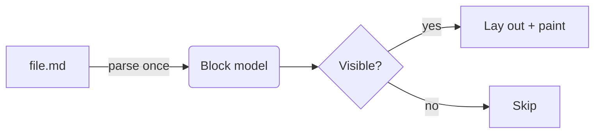

# mdview demo

A **tiny** Markdown viewer, rendered on the GPU with *GPUI* — the same UI framework as [Zed](https://zed.dev). It supports `inline code`, ~~strikethrough~~, and [internal links](#tables).

## Lists

- First item
- Second item with **bold** text
  - Nested item
  - Another nested one
- [x] Done task
- [ ] Pending task

1. One
2. Two
3. Three

## Quotes and callouts

> Simplicity is prerequisite for reliability.
> — Edsger W. Dijkstra

> [!TIP]
> Open several files at once: `mdview a.md b.md`. Running `mdview` again adds tabs to the existing window.

> [!WARNING]
> This is a prototype.

## Code

```rust
/// Greets everyone in `names`.
#[inline]
fn greet<'a>(names: &[&'a str]) -> Vec<String> {
    let mut out = Vec::with_capacity(names.len());
    for n in names {
        out.push(format!("Hello, {n}!")); // one line each
    }
    out
}
```

```python
@dataclass
class Point:
    x: float = 0.0

    def norm(self) -> float:
        """Distance to the origin."""
        return math.hypot(self.x, 0)  # 2D for now
```

```sh
# Build and open a file in a separate instance
cargo build --release && MDVIEW_TRACE_STARTUP=1 ./target/release/mdview -n "$HOME/notes.md"
```

```json
{ "name": "mdview", "version": "0.1.0", "private": true, "tags": ["gpui", null] }
```

```diff
@@ -1,3 +1,3 @@
-let theme = Theme::dark();
+let theme = Theme::for_appearance(window.appearance());
 render(theme);
```

## Math

Inline math such as $e^{i\pi} + 1 = 0$ or $\alpha_i \le \beta_{ij}$ flows with the text, and display math is typeset like KaTeX:

$$
\int_0^\infty e^{-x^2}\,dx = \frac{\sqrt{\pi}}{2}
\qquad
\sum_{n=1}^{\infty} \frac{1}{n^2} = \frac{\pi^2}{6}
$$

## Diagrams



## Tables

| Feature        | Status | Notes                    |
|----------------|:------:|-------------------------:|
| Tabs           |   ✓    | Ctrl+Tab to switch       |
| Live reload    |   ✓    | Watches file mtime       |
| Single instance|   ✓    | Unix socket, like Zed    |

---

Footnote reference[^1] and a [link to the other demo](second.md).

[^1]: Footnotes render at the end.
